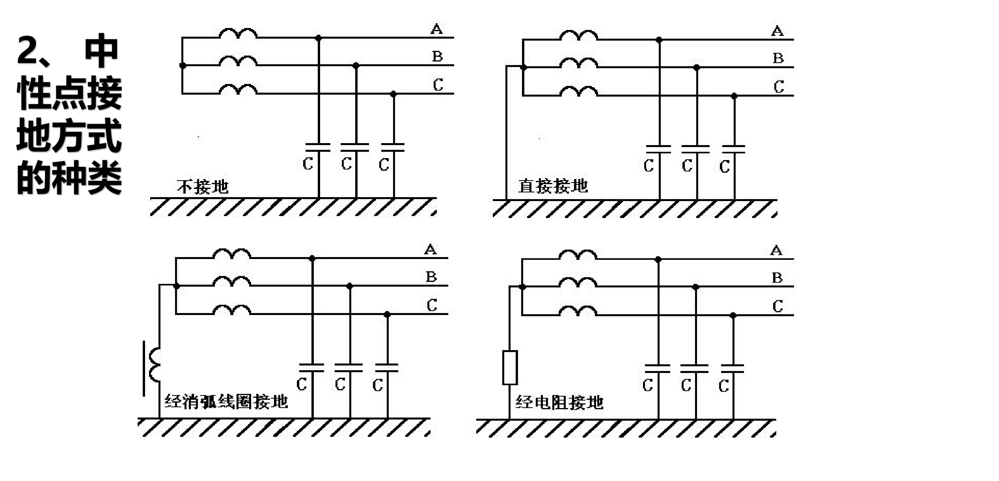
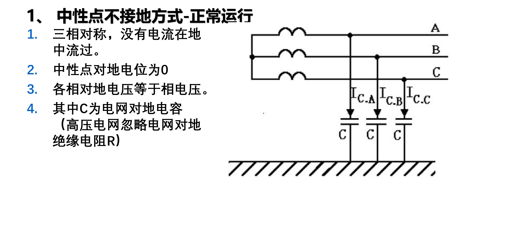
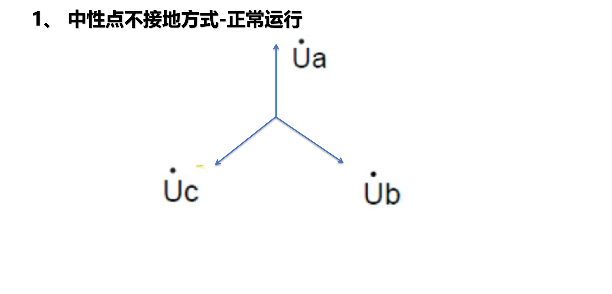
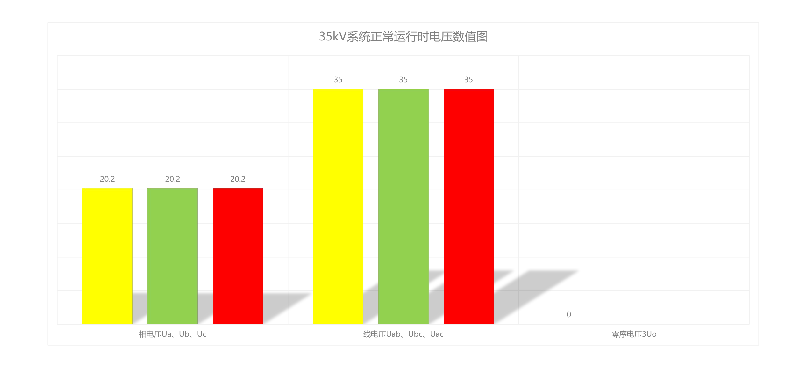
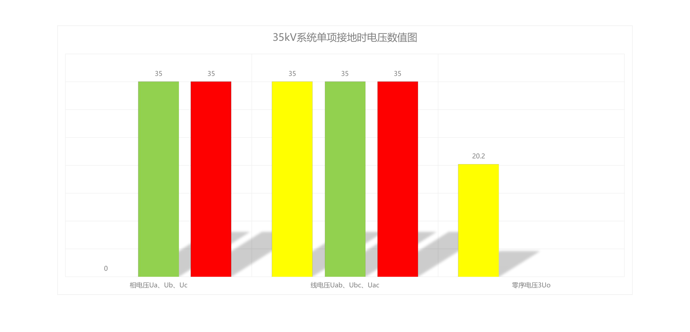
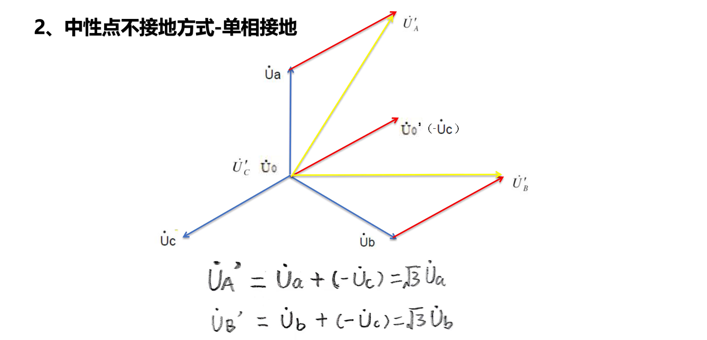
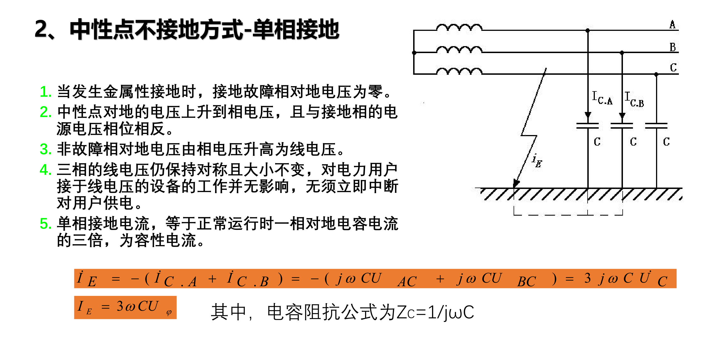
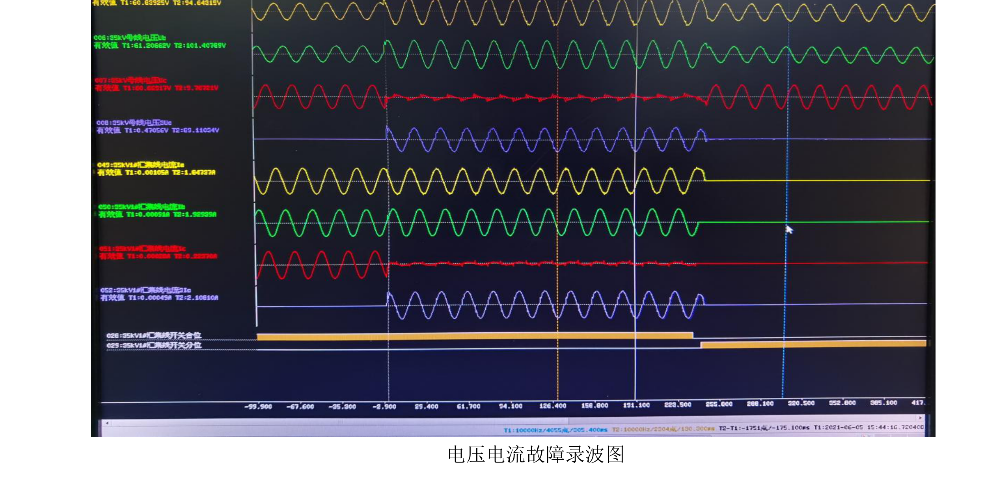
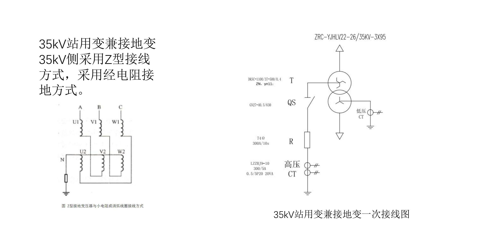
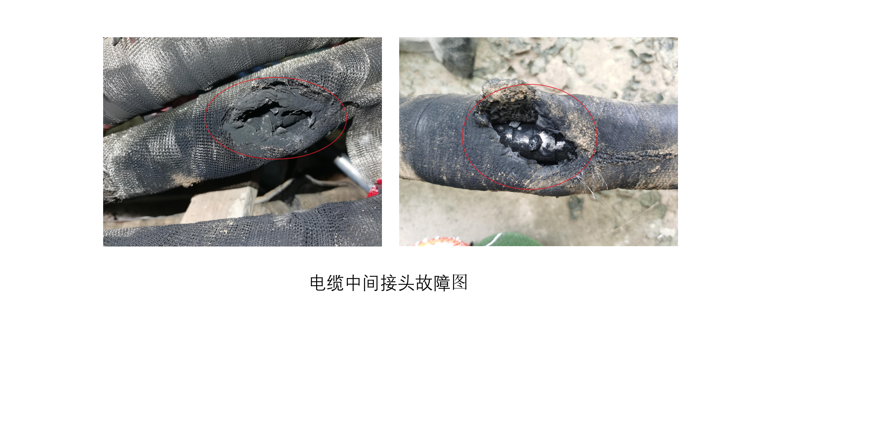

# 35kV 系统单相接地故障与 PT 熔断器熔断：从零理解到现场判别

> **这份文档是什么**：一份可以独立阅读的技术知识整理，面向"懂一点电、但不是继保专业"的读者。目标不是让你背结论，而是让你看到任何一个电压数字，都能推出它背后的因果。
>
> **素材来源**：以《35kV系统单相接地故障与PT熔断器故障分析》（协鑫集团，31 页 PPT）为骨架，结合公开文献与工程规范做了大量补全。
>
> **标注规则**：
> - 句末标「PDF 第 N 页」的，是该材料的原有内容；
> - 标 **补充** 的，是该材料没有、由本文补上的推导、数据、机理或工程经验；
> - 标「参考：…」的，是外部文献来源；
> - **公式的具体写法、图中的数值读数、原文中存疑的表述，一律不写进正文**，统一收在《待人工核对清单.md》里。
>
> **怎么读**：第一次读，按顺序从第 1 章读到第 25 章；只想解决现场问题，直接跳第 16～20 章（判别），遇到不懂的概念再回头查。附录 B 是术语表，附录 C 是公式速查。

---

# 第一篇 打地基

## 第 1 章 35kV 系统里都有什么

> **这一章解决**：把一次系统、二次系统摆到一张图上，后面所有讨论才有落点。看不懂这一章，后面全是空中楼阁。

### 1.1 先建立一个空间概念

35kV 在电力系统里属于**中压配电**。它很少直接给居民供电，主要出现在两个地方：

- **城市配电网**：从 110kV 变电站降压到 35kV，再分送到各个 10kV 配电所
- **新能源电站**：光伏组件发出直流电，经逆变器变成交流，升压到 35kV，再用 35kV 集电线路汇集到升压站

后者尤其重要，因为这份材料的背景正是光伏电站。

一条典型的光伏电站电能路径：

```
光伏组件 → 逆变器(约 0.4kV) → 箱式变压器(升到 35kV) → 35kV 集电线路
    → 35kV 母线 → 主变压器(升到 110kV 或 220kV) → 送出电网
```

**补充**：注意"35kV 母线"这个位置——它是整个电站电能汇集的十字路口。本文讨论的所有电压现象，绝大多数都是在**母线 PT** 上观察到的。

### 1.2 一次系统：真正扛高压的部分

一次系统指直接参与电能传输的设备。对 35kV 而言，主要包括：

| 设备 | 作用 | 类比 |
|---|---|---|
| 母线 | 汇集和分配电能 | 公共交通的枢纽站 |
| 出线 / 进线 | 电能进出的通道 | 公交线路 |
| 断路器 | 正常通断 + 故障时切断短路电流 | 带保险的总开关 |
| 隔离开关 | 检修时形成明显断开点 | 手动闸刀，不能带负荷操作 |
| 变压器 | 改变电压等级 | 齿轮箱 |
| 电缆 / 架空线 | 输送电能 | 管道 |
| 接地变压器 | 人为制造一个中性点 | 见第 21 章 |
| 避雷器 | 限制过电压 | 泄压阀 |

### 1.3 二次系统：测量、保护、控制

二次系统是"看"和"管"的部分，电压低（通常 100 V 量级）、电流小（5 A 或 1 A 量级）。三只关键的"眼睛"：

- **PT（电压互感器，Potential/Voltage Transformer）**：把 35kV 按比例变成 100 V 左右，供测量和保护使用
- **CT（电流互感器，Current Transformer）**：把几百安的电流按比例变成 5 A 或 1 A
- **继电保护装置**：接收 PT、CT 的信号，判断系统是否故障，决定是否跳闸

### 1.4 全文最重要的一条分界线：一次 vs 二次

**补充**：请务必记住这条分界线，因为本文讨论的三类现象，本质区别就在这里：

| | 发生在哪 | 后果 | 处置对象 |
|---|---|---|---|
| 单相接地 | **一次系统** | 真实的电气故障，有实际接地点 | 线路、设备 |
| PT 一次熔断 | **二次系统的"源头"**（PT 本身） | 测量失真 | PT 间隔 |
| PT 二次断线 | **二次回路** | 测量中断 | 二次回路 |

一句话：**真故障发生在一 次侧，假信号产生在二次侧。** 判别的一切技巧，都是围绕这个层级差异设计的。

---

## 第 2 章 中性点：一切电压现象的源头

> **这一章解决**：为什么同样是一次单相接地，在不同的系统里，后果可以天差地别。

### 2.1 什么是中性点

三相绕组按**星形（Y）**接法时，三个绕组的尾端连在一起，这个公共连接点就叫**中性点**。

正常运行时，三相电压对称（大小相等、相位互差 120°），这个公共点的电位刚好等于大地的电位——**中性点对地电压为零**。这不是巧合，而是三相对称的必然结果。

### 2.2 中性点的四种处理方式

PDF 第 4 页用四张并排的接线图展示了四种方式：


*图源：PDF 第 4 页。四张图结构相同，唯一差别在电源中性点怎么处理。*

**读图方法**（只看三个位置）：

1. 看**电源三个绕组**（左侧三个线圈）的尾端连在哪里
2. 看这个公共点**有没有接地、经什么接地**
3. 看三条母线下**各挂的对地电容 C**——这个后面第 3 章要用

| 方式 | 中性点接法 | 图上特征 |
|---|---|---|
| 不接地 | 悬空 | 公共点什么都没接 |
| 直接接地 | 直接连地 | 公共点直通地 |
| 经消弧线圈接地 | 经电感接地 | 公共点串一个线圈（电感） |
| 经电阻接地 | 经电阻接地 | 公共点串一个电阻 |

### 2.3 为什么中性点方式能决定一切

关键在于**单相接地时，故障电流走哪条路**：

- **中性点直接接地**：A 相接地时，A 相 → 地 → 中性点 → A 相绕组，形成一条**低阻抗的金属回路**。故障电流可达数千安，本质上是"单相短路"，必须立即跳闸切除。
- **中性点不接地**：A 相接地时，地这一路是断开的（中性点悬空），电流没有低阻抗回路可走。唯一能流通的，是**另外两相对地电容**充放电形成的容性电流——这条路的阻抗极大，电流只有几安到几十安。

**这就是"大接地电流系统"和"小接地电流系统"这两个名称的真正含义**：不是按电压等级分，而是按**单相接地时故障电流的大小**分。

PDF 第 3 页的分类正是按这个逻辑：

1. **中性点接地 → 大接地电流系统**：①直接接地（又称有效接地）②经低阻接地
2. **中性点不接地 → 小接地电流系统**：①不接地（又称中性点绝缘）②经消弧线圈接地 ③经高阻接地

### 2.4 35kV 系统实际怎么选

**补充**：35kV 系统两种都常见，取决于场景：

- **传统电网和多数工业用户**：中性点不接地或经消弧线圈接地。理由是供电可靠性——单相接地时线电压不变，用户可以继续用电，允许带故障运行 1～2 小时（规程口径）。
- **光伏、风电等新能源电站**：越来越多采用**小电阻接地**。原因是这些电站电缆化率高，对地电容大，单相接地时的电容电流很大，靠"硬扛"风险高。

PDF 第 7 页有一句关键的行业背景：

> (1)光伏电站35kV电力系统多为中性点不接地系统，如果经接地小电阻接地，对电网系统安全运行更有利。问题的关键是：主变压器低压侧一般为三角形接地，没有中性点引出，这里就需要装设专用接地变，人为创造一个中性点。

这句话信息量很大，拆成三层：

1. **现状**：光伏电站 35kV 多为不接地
2. **趋势**：改小电阻接地更有利
3. **障碍**：主变低压侧接成三角形，**没有中性点可引**，必须额外装一台接地变"造"一个

第 3 点引出了第 21 章要讲的接地变。这里先记住结论：**中性点不是天然就有的，三角形接法的系统根本没有中性点，要用就得自己造。**

---

## 第 3 章 对地电容：零序电流的来处

> **这一章解决**：单相接地的故障电流到底从哪来？答案是一个平时几乎没人注意的东西——对地电容。

### 3.1 导线和大地之间，天生就有电容

任何带电导体和大地之间，都存在电容。两条平行导体（导线和大地）构成一个电容器的两个极板，中间是空气或电缆绝缘层。

对 35kV 系统来说：

- **架空线路**：对地电容较小
- **电力电缆**：对地电容大得多。因为电缆的导体与金属屏蔽层/铠装层之间距离极近（毫米级绝缘），相当于一个"平板间距很小"的电容器

**补充**：这就是光伏电站的麻烦所在。一个光伏电站的 35kV 集电线路可能全是电缆，对地电容总量很大，单相接地时能提供的电容电流也很大——大电容电流会带来弧光接地过电压、PT 熔断等一系列问题，第 22 章细讲。

### 3.2 正常运行时，这些电容电流去哪了


*图源：PDF 第 8 页。三条母线下各挂一个对地电容 C，电流标为 I_C.A、I_C.B、I_C.C。*

PDF 第 8 页给了四条要点：

1. 三相对称，没有电流在地中流过
2. 中性点对地电位为 0
3. 各相对地电压等于相电压
4. 图中 C 为电网对地电容（高压电网忽略电网对地绝缘电阻 R）

**补充——第 1 条最容易被误读**。"没有电流在地中流过"不是说对地没有电流，而是说：

- 每一相对地**都有**电容电流（大小都是 ωC·U相）
- 但三相电压互差 120°，三个电流的**矢量和恰好为零**
- 所以流入大地的**净电流**为零

用生活化的说法：三个人同时往三个方向拉车，力气一样大、方向正好互成 120°，车不动——但三个人各自都在使劲。三相电容电流就是这种情况：每一相都在"往地里送电流"，但总和为零。

**这个"净电流为零"就是零序电流为零的物理来源。** 后面单相接地时"净电流突然出现"，原因就在于三相对地电压的对称性被破坏了。

---

## 第 4 章 PT：系统的眼睛

> **这一章解决**：PT 到底是什么、它为什么必须有、以及它坏了之后为什么"看起来还是好的"。

### 4.1 PT 是什么

PT（电压互感器）本质上是一台**小容量变压器**。一次绕组接在高压母线上，二次绕组输出一个成比例的低压。

PDF 第 17 页的定义：

> 电压互感器PT和变压器类似，是用来变换电压的仪器。电压互感器变换电压的目的，主要是用来给测量仪表和继电保护装置供电，用来测量线路的电压、功率和电能，或者用来在线路发生故障时保护线路中的贵重设备、电机和变压器。

PDF 第 18 页讲结构：与变压器相似，有一次绕组、二次绕组，都绕在铁芯上，绕组之间及与铁芯之间都有绝缘，实现电气隔离。

PDF 第 22 页讲三个作用：

1. 把一次回路的高电压按比例变换成 100 V 或更低等级的标准二次电压
2. 将一次侧高压与二次侧工作人员隔离，二次侧可设接地点
3. 使二次回路可采用低电压控制电缆，布线简单，便于远方控制

### 4.2 为什么非要用它

三个理由，缺一不可：

- **安全**：35kV 不能直接接到仪表和继电器上
- **标准化**：所有仪表、保护装置统一按 100 V 量级设计，便于互换
- **隔离**：二次侧接地后，即使一次侧出问题，二次设备也安全

### 4.3 35kV 母线 PT 的典型接线：星形 + 开口三角

**补充**：这是理解全部判别逻辑的基础，PDF 只提了一句（第 19 页"三绕组电压互感器……还有一组辅助二次侧，供接地保护用"），这里展开。

35kV 母线的典型配置是**三只单相 PT 接成 YN,yn**，外加一组开口三角绕组：

```
一次侧：   A ──[PT-a]──┐
           B ──[PT-b]──┼── 中性点（接地）
           C ──[PT-c]──┘

二次侧（基本二次）：三个二次绕组接成星形，中性点接地
   → 能测出三相对地电压（相电压）和三个线电压

辅助二次（开口三角）：三个绕组首尾串联，留一个开口
   → 开口两端输出 = 三个二次电压的矢量和 × 3 的折算
   → 正常情况下三相电压矢量和为零，开口无输出
   → 一旦出现零序电压，开口就有输出，触发"母线接地"告警
```

**为什么叫"开口三角"**：三个绕组本来可以首尾相接闭合成三角形，但故意留一个口不接，把两端引出来测量。这样三角形里流不出环流，但开口两端能测到"三相电压之和"。

**关键推论**（后面反复用到）：**开口三角有电压，说明三相电压不平衡了。** 但"不平衡"的原因可能是单相接地，也可能是 PT 自己坏了——这正是第 15 章要讲的判别难点。

### 4.4 二次侧电压口径：不懂这个，所有数字都读不出来

**补充**：这是本文最实用的一组数字，PDF 完全没有涉及。

35kV 系统 PT 二次侧的额定值：

| 量 | 额定值 | 说明 |
|---|---|---|
| 二次相电压 | 100/√3 ≈ **57.7 V** | 对应一次侧的对地相电压 20.2 kV |
| 二次线电压 | **100 V** | 对应一次侧线电压 35 kV |
| 开口三角每相 | 100/3 ≈ 33.3 V | 小电流接地系统的典型设计 |
| 开口三角总额定 | **100 V** | 三相串联后，对应 3U₀ 的额定值 |

**补充——为什么开口三角每相是 100/3 而不是 100**：这是小电流接地系统特有的设计。单相金属性接地时，非故障相电压升高 √3 倍，三相二次电压的矢量和会达到正常值的 3 倍（即 300 V 量级）。而接到开口三角上的保护装置额定电压是 100 V，为了"故障时正好达到 100 V 不超限"，就把每相绕组做成 100/3 V，三相串联后故障时正好 100 V。

大电流接地系统（如 220kV）情况不同，单相接地时非故障相电压不变，所以开口三角每相取 100 V。

**这组数字的用处**：当你看到录波图上某相电压是 94 V，就能立刻判断——它接近 100 V 的线电压额定，说明这一相"升高到了线电压"，是真接地的特征；如果看到 3.4 V，说明故障相残余电压很低。**不知道这个口径，94 V 会被误读成"过电压"，3.4 V 会被误读成"完全接地"。**

### 4.5 为什么说 PT 是"会撒谎的眼睛"

这是本章最想让你记住的一点。

PT 损坏（一次熔断、二次断线）之后，它输出的**仍然是格式完全合法的电压值**——保护装置和后台收到的是一组"看起来正常的数据"，只是这组数据不对应真实的系统状态。

**补充**：这就好比汽车的速度表坏了，指针还是会动，只是指的位置不对。仪表本身没有"我坏了"的报错功能，除非专门做自检。所以：

- 系统真的接地 → 电压异常
- PT 坏了 → 电压**也**异常

两者在数据形态上高度相似，而保护装置和值班员一开始只知道"电压异常了"。**判别的工作，本质上就是判断"这个异常到底是系统的，还是仪表的"。**

---

# 第二篇 单相接地故障

## 第 5 章 正常运行的电压画像

> **这一章解决**：先建立"正常"的基准。没有基准，任何异常都无从判断。

### 5.1 三个必须分清的"电压"

讨论电压之前，先把三个概念摆清楚。**这是初学最容易混的地方，混了后面全乱。**

| 名称 | 定义 | 测的是哪两点之间 | 35kV 下的大小 |
|---|---|---|---|
| **相电压** Uφ | 每一相对地的电压 | 一根相线 ↔ 大地 | 35/√3 ≈ 20.2 kV |
| **线电压** U线 | 两根相线之间的电压 | A 相 ↔ B 相 | 35 kV |
| **零序电压** U₀ | 三相电压的矢量和 ÷ 3 | 概念量，通过开口三角取得 | 正常时 0 |

三者关系：

- **U线 = √3 × Uφ**（因为两相电压夹角 120°，差矢量长度是 √3 倍）
- **U₀ = (U̇a + U̇b + U̇c) / 3**（三相平衡时为零）
- 工程上更常用 **3U₀**（三相电压直接相加），因为开口三角输出的就是 3U₀ 的折算值

### 5.2 35kV 的电压画像


*图源：PDF 第 9 页。U̇a、U̇b、U̇c 三个相量长度相等、互差 120°。*


*图源：PDF 第 12 页。相电压 20.2，线电压 35，零序电压 0。*

把这两张图对上：相量图上三个箭头一样长（相电压相等），数值图上三根柱子一样高（20.2）；线电压是三者之间的连线长度，等于相电压的 √3 倍（35）；零序电压那根柱子为零，因为三个相量首尾相接正好闭合。

### 5.3 三相对称到底意味着什么

"三相对称"这句话包含四层含义，每一层都对应一个"为零"或"相等"的结论：

1. **三个相电压大小相等** → 每一相对地电压都是 20.2 kV
2. **相位互差 120°** → 三个相量首尾相接恰好闭合
3. **矢量和为零** → U₀ = 0，开口三角无输出
4. **三个对地电容电流也矢量和为零** → 流入大地的净电流为零

**补充**：第 4 层是第 3 章讲过的内容，这里再强调一次——它和"零序电流为零"是同一件事的两种说法。理解了这一点，后面单相接地时"突然出现零序电流"就顺理成章：**不是凭空冒出来的，是原本相互抵消的那三个电流失去平衡了。**

---

## 第 6 章 单相接地：电压到底怎么变

> **这一章解决**：单相接地时，三个相电压、三个线电压、零序电压分别变成多少，以及为什么。这是全篇的核心推导，请一步一步跟着走。

### 6.1 先定义"金属性接地"

**金属性接地**：接地点的电阻近似为零，比如导线直接掉在地上、导体直接碰到接地金属外壳。

这是理想情况，实际很少见，但它是最容易分析、也最能说明问题的基础工况。实际工况（有过渡电阻）在第 9 章讨论。

### 6.2 五步推导

假设系统是中性点不接地，A 相发生金属性接地。设三个电源相电压为 Ėa、Ėb、Ėc（三者之和为零，互差 120°，大小都是 E = 20.2 kV）。

**第 1 步：A 相被强行拉到地电位**

A 相接地 → A 相对地电压变成 0。记作 U̇′a = 0。

**第 2 步：中性点被迫位移**

这是最关键的一步。接地后，"中性点对地电压"不再是 0 了。设它为 U̇₀。

从 A 相看：A 相对地电压 = A 相电源电压 + 中性点位移量 = Ėa + U̇₀。

既然已知 U̇′a = 0，就有：

```
Ėa + U̇₀ = 0   →   U̇₀ = −Ėa
```

**中性点位移量等于故障相电源电压的反相**，大小等于相电压 20.2 kV。这个结论是整张相量图的核心，请记住。

**第 3 步：B 相的新电压**

B 相对地电压 = B 相电源电压 + 中性点位移量：

```
U̇′b = Ėb + U̇₀ = Ėb − Ėa
```

Ėb 与 Ėa 互差 120°，两个等长矢量相减，差矢量长度是 √3 倍（几何推导见 7.4 节）：

```
|U̇′b| = √3 × E = √3 × 20.2 ≈ 35 kV
```

**B 相的对地电压从 20.2 kV 升高到了 35 kV——恰好等于线电压。**

**第 4 步：C 相同理**

```
U̇′c = Ėc − Ėa ，   |U̇′c| = √3 × E ≈ 35 kV
```

**第 5 步：线电压为什么不变**

这一步最能体现物理直觉的威力。算一下接地后的 A、B 两相之间的电压：

```
U̇′ab = U̇′a − U̇′b
      = (Ėa + U̇₀) − (Ėb + U̇₀)
      = Ėa − Ėb
      = U̇ab（接地前的线电压，未变）
```

看到了吗？**中性点位移量 U̇₀ 在相减的时候直接抵消掉了。** 线电压是"两相之差"，而位移量对三个相是共同的、等量叠加的，所以做差时被完全消去。

同理 U̇′bc、U̇′ca 也都不变。

**这就是"单相接地时线电压不变、用户可以继续用电"的全部物理原因。** 不是因为"故障轻"，而是因为中性点位移这个共同分量在相减时被消掉了。

### 6.3 结论汇总

| 物理量 | 正常 | A 相金属性接地 |
|---|---|---|
| A 相对地电压 | 20.2 kV | **0** |
| B 相对地电压 | 20.2 kV | **35 kV（升高 √3 倍）** |
| C 相对地电压 | 20.2 kV | **35 kV（升高 √3 倍）** |
| 线电压 Uab / Ubc / Uca | 35 kV | **35 kV（不变）** |
| 中性点对地电压 | 0 | **20.2 kV，方向与 A 相电源电压相反** |
| 零序电压 U₀ | 0 | **−Ėa，大小 20.2 kV** |
| 3U₀ | 0 | **60.6 kV（一次侧）** |


*图源：PDF 第 13 页。相电压 0 / 35 / 35，线电压 35 / 35 / 35。*

### 6.4 必须指出的一处口径问题

**补充**：PDF 第 13 页的柱状图上，"零序电压 3U₀"那一根柱子标的是 **20.2**。

按定义，金属性接地时 U₀ 的大小是 20.2 kV（等于相电压），而 **3U₀ 的大小应该是 3 × 20.2 ≈ 60.6 kV**。图上标的 20.2 实际是 U₀ 的数值，却放在了"3U₀"的类别下——这是口径混用。

为什么要在意这个差别：

- 如果你拿 20.2 去核对二次侧开口三角的整定值，会对不上。二次侧 3U₀ 额定对应 100 V，20.2 kV 对应的是 U₀（一次），不是 3U₀。
- 如果你说"3U₀ 只有 20.2 kV"，会被理解成接地的零序电压很小，进而误判"接地不严重"。

正确写法：**U₀ ≈ 20.2 kV，3U₀ ≈ 60.6 kV（一次侧）；折算到二次，3U₀ 对应开口三角约 100 V。**

**文献可以佐证这个口径**。教科书对三相五柱式 PT 的描述是：

> 剩余线圈每相电压按 100/3 V 设计接成开口三角形，正常时开口三角形两端电压为零。**一相完全接地时，开口三角形两端出现 100 V 电压（零序电压的三倍）**，以供给绝缘监视的继电器使其动作发出信号。另接在二次线圈的电压表读数发生变化，接地相的电压表读数为零，未接地相电压表读数升高 √3 倍。

这段话把三件事一次说清了：开口三角每相 100/3 V、完全接地时输出 100 V、非故障相升高 √3 倍——三条都与本文的表述一致，也反向印证了"3U₀ 不是 20.2"。

这份材料的其余结论（故障相归零、非故障相升到线电压、线电压不变）都是对的，只有这一个标注需要修正。修正记录见附录 D。

---

## 第 7 章 相量图：手把手教会你读

> **这一章解决**：PDF 第 11 页那张红黄蓝箭头的图，为什么大多数人看不懂，以及怎么一步步读出来。

### 7.1 相量图到底是什么

交流电的电压是随时间变化的正弦波，直接画波形图很占地方。**相量图**是另一种画法：用一个箭头同时表示两个信息——

- **箭头的长度** = 电压的有效值（大小）
- **箭头的角度** = 电压的相位（超前还是滞后）

这样，加法就变成"矢量相加"（首尾相接或平行四边形法则），非常直观。

### 7.2 先看懂正常的三相


三个箭头长度相等，互成 120°。这就是三相对称：

- 相等 → 三个相电压大小一样
- 120° → 首尾相接正好闭合一个等边三角形
- 闭合 → 矢量和为零 → 零序电压为零

### 7.3 再看接地后的那张图


*图源：PDF 第 11 页。蓝色是正常三相，红色是中性点位移量和合成电压，黄色是接地后的非故障相电压。*

这张图上的元素较多，先识别清楚：

| 元素 | 颜色 | 含义 |
|---|---|---|
| U̇a、U̇b、U̇c | 蓝 | 正常三相电压（接地**前**） |
| U̇₀（标着 −U̇c） | 红 | 中性点位移量 |
| U̇′_A、U̇′_B | 黄 / 红 | 接地**后**的非故障相电压 |
| U̇′_c | 蓝 | 接地后的故障相电压，长度为零 |

**先注意一件事**：这张图用的例子是 **C 相接地**，证据就是那个"−U̇c"。位移量总是等于**故障相**电源电压的反相。

**读图三步法**：

**第 1 步：找到故障相，画出位移量**
C 相接地 → C 相对地电压被拉到 0 → 位移量 U̇₀ = −U̇c，方向与 U̇c 相反，长度等于相电压。图上那条红色、标注 −U̇c 的箭头就是它。

**第 2 步：对每个非故障相，做"原电压 + 位移"**
- A 相：从原点出发，先按 U̇a 走一段，再按 U̇₀ 走一段，终点就是 U̇′_A
- 图上那条**红箭头**画的是 U̇₀ 本身，那条**黄箭头**画的是从 U̇a 端点指向 U̇′_A 的连线——它代表"位移量引起的增量"

**第 3 步：量长度**
- U̇′_A 的长度 = √3 × U̇a 的长度（图上公式写的就是这个）
- U̇′_B 的长度 = √3 × U̇b 的长度
- U̇′_c 的长度 = 0（故障相归零）

### 7.4 为什么正好是 √3 倍

这不是近似，是几何的必然。

U̇a 和 U̇c 的夹角是 120°。U̇′_A = U̇a − U̇c，即两个等长矢量（长度都是 E）相减。

用余弦定理求差矢量长度：

```
|U̇a − U̇c|² = E² + E² − 2·E·E·cos120°
             = 2E² − 2E²·(−0.5)
             = 2E² + E²
             = 3E²
|U̇a − U̇c| = √3 · E
```

所以非故障相电压 = √3 × 相电压 = 线电压。**"升高到线电压"不是巧合，是 120° 夹角决定的几何结果。**

### 7.5 这张图的两个坑

**补充**：这张图有两个人容易踩的坑，如果不指出来，读图会读出一堆矛盾。

**坑一："电压相量"和"位移相量"挤在原点**

图上 U̇′_c 和 U̇₀ 都画在原点附近，看起来像两个短箭头叠在一起。但它们的含义完全不同：

- U̇′_c 是"接地后 C 相的对地电压"，长度为零（C 相接地了，对地没电压）
- U̇₀ 是"中性点移动了多少"，长度等于一个相电压

一个是**结果**，一个是**原因**，长度差了一个相电压。之所以都在原点，只是因为它们的起点恰好都是原点。

**坑二：示例相别和正文对不上**

这份材料的相别不统一：

- 第 10 页的接线图和文字分析，讲的是 **A 相**接地
- 第 11 页的相量图，用的是 **C 相**接地（−U̇c）
- 第 12、13 页的数值图，又是 **A 相**为 0

初学者读到这会以为前后矛盾。正确理解是：**结论与相别无关**。任取哪一相接地，结果都是"该相归零、另外两相升高 √3 倍、线电压不变"。看相量图时，只认准一条：**位移量 = 故障相电压的反相**，就不会被相别绕晕。

### 7.6 给自己一个自检方法

读完一张相量图，用三个问题自检：

1. **故障相是否归零？** 图上它的相量长度是不是最短？
2. **非故障相是否比正常相量长 √3 倍？** 数格子或者比长度
3. **任意两个非故障相之间的差，是否和正常时一样长？** 这对应"线电压不变"

三问都过，说明读对了。

---

## 第 8 章 故障电流：为什么恰好是 3 倍

> **这一章解决**：PDF 只给了结论"等于一相对地电容电流的三倍"，没给为什么。这里补完整推导。

### 8.1 公式长什么样


*图源：PDF 第 10 页。右侧是接线图（三相电源 + 三相对地电容 + 故障点），左侧是分析要点，底部是公式（图片形式）。*

PDF 给出的公式（底部橙色块）：

```
İ_E = −(İ_C.A + İ_C.B) = −(jωC·U_AC + jωC·U_BC) = 3jωC·Ǚ_C
I_E = 3ωC·U_φ
附注：其中，电容阻抗公式为 Z_C = 1/jωC
```

### 8.2 符号逐个解释

| 符号 | 读作 | 含义 | 35kV 下的量级 |
|---|---|---|---|
| I_E | I 下标 E | 单相接地故障电流（流过故障点） | 由电容总量决定 |
| I_C.A、I_C.B | I 下标 C 点 A | 非故障相（A、B）的对地电容电流 | 每相约几安 |
| C | C | 每相对地电容 | 由电缆长度决定 |
| U_AC、U_BC | U 下标 AC | 线电压（非故障相之间） | 35 kV |
| U_φ | U 下标 φ(phi) | 相电压 | 20.2 kV |
| ω | 欧米伽 | 角频率，ω = 2πf = 314 rad/s（f=50Hz） | 常数 |
| Z_C | Z 下标 C | 电容的阻抗，1/jωC | — |

### 8.3 为什么是 3 倍：完整推导

这个推导分两层，缺一层都得不出 3。

**第一层：单相接地后，非故障相的电容电流变大了多少？**

正常时，一相电容电流：I_C = ωC·Uφ

接地后，非故障相（A、B）对地电压从 Uφ 升到了 √3·Uφ（第 6 章已推），所以它们的电容电流：

```
I′_C = ωC × (√3·Uφ) = √3 × I_C
```

**单相的电容电流变成了 √3 倍。** 这是第一个 √3。

**第二层：两个这样的电流同时流向故障点，怎么相加？**

**本节沿用 PDF 公式的符号，以 C 相接地为例，非故障相记为 A、B。相别不影响任何结论。**

两个非故障相的电容电流都要流经故障点。它们不是同方向的，而是有相位差：

- 接地后，两个非故障相的新电压**夹角不再是 120°，而是 60°**——因为两者都叠加了同一个位移量 U̇₀，相位被"拉近"了。可以验算：新电压分别落在 −150° 和 +150° 方向，取小角差正好 60°。容性电流统一超前各自电压 90°，所以两个电流的夹角也是 60°。
- 两个大小相等、夹角 60° 的矢量相加，合矢量长度为 `2 × |I| × cos(60°/2) = 2 × |I| × cos30°`

代入 |I| = √3·I_C：

```
I_E = 2 × (√3·I_C) × cos30°
    = 2 × √3 × I_C × (√3/2)
    = 3 × I_C
```

**第二个 √3 和 cos30° 里的 √3/2 相乘，正好凑成 3。**

所以"3 倍"的来历是：**电压升高贡献一个 √3，两矢量合成的几何关系再贡献一个 √3，相乘得 3。** 两个效果叠乘，不是相加。

**补充**：这个结论在文献里有独立佐证。1981 年《继电器》刊载的《ZD-3B 小接地电流信号选择装置》给出了同样的推导与结果：非故障相电容电流有效值 I_B = I_C = √3·Uφ·ωC₀，流过接地点的有效值 I_D = 3·Uφ·ωC₀（[原文](https://www.dlbh.net/dlbh/ch/reader/create_pdf.aspx?file_no=19810202&flag=1&year_id=1981&quarter_id=2)）。

### 8.4 这个公式什么时候不能用

**补充**：PDF 没列适用条件，但没有条件就没有结论。以下五条必须同时满足：

1. **中性点不接地**——没有消弧线圈、没有接地电阻。一旦装了消弧线圈，电感电流会抵消容性电流，故障点电流变成两者的差值，公式失效。
2. **金属性接地**——忽略接地过渡电阻。有电阻时故障电流更小，且故障相不归零。
3. **忽略对地绝缘电阻**——高压电网容性电流远大于泄漏电流（PDF 第 8 页也这么说）。
4. **忽略线路串联电感**——工频下容性电流占主导。
5. **三相对地电容相等**——否则 C 不唯一，要分相计算。

**条件不满足时，公式只给量级，不能直接拿去整定保护。**

### 8.5 建立数量级直觉

**补充**：光有公式没有感觉，等于没学会。给几个参照：

- 一条 35kV 电缆线路，对地电容电流通常是**几安到几十安**量级
- 一个电缆化率高的光伏电站，全站电容电流可能达到**几十安到上百安**
- 单相接地故障电流 = 3 × 单相电容电流，所以也在**十几安到几百安**这个区间

对比一下：小电阻接地系统的故障电流是**几百安**（按接地电阻设计），而中性点直接接地系统是**几千安**。三个数量级清清楚楚：

| 接地方式 | 单相接地电流量级 | 后续动作 |
|---|---|---|
| 不接地 | 几安 ~ 几十安 | 告警，允许运行 1~2 小时 |
| 经消弧线圈 | 补偿后残流更小（通常 < 10 A） | 告警，可继续运行 |
| 经小电阻 | 几百安（设计值） | 零序过流保护跳闸 |
| 直接接地 | 几千安 | 立即跳闸 |

**这张表值得记住**：现场看到故障电流是几十安还是几百安，几乎可以直接反推系统的接地方式。

---

## 第 9 章 非金属性接地与弧光接地：现实中的样子

> **这一章解决**：金属性接地是"教科书工况"，现实中很少见。真实接地长什么样，以及它会制造什么陷阱。

### 9.1 现实中的接地，大多数不是"归零"

**补充**：金属性接地要求接地电阻近似为零。现实中绝大多数接地点都有过渡电阻：

| 场景 | 过渡电阻量级 | 表现 |
|---|---|---|
| 导线断落搭在潮湿地面 | 几十 ~ 几百 Ω | 故障相电压很低但不为零 |
| 绝缘子污闪 / 闪络 | 几十 ~ 几千 Ω | 故障相电压明显降低 |
| 树枝搭接导线 | 几千 Ω ~ 几十 kΩ | 故障相电压降低，但仍有可观值 |
| 电缆受潮 / 中间接头劣化 | 变化范围大 | 可能渐进发展 |

**共同特征**：故障相电压**降低，但不归零**；非故障相升高的幅度**小于 √3 倍**；零序电压**小于满值**。

### 9.2 为什么"不归零"是最危险的认识陷阱

这一点必须单独强调，因为它是第 19 章"易混边界"里的头号坑。

很多人脑子里有一个简化结论：

> "单相接地时，故障相电压归零。"

于是当他看到某相电压降到 5 kV 而不是 0 时，就会想："没归零啊，那可能不是接地，是不是 PT 熔断了？"

这个推理错在**把金属性接地的特例当成了接地的普遍定义**。

正确的判断方法是看**另外两相**：

> 非故障相是否升高到接近 √3 倍（线电压）？

- 升高了 → 中性点确实位移了 → **是真的接地**（不管故障相有没有归零）
- 没升高 → 中性点没动 → 不是接地，问题在测量侧

**判断"是不是接地"，看的是"另外两相有没有升高"，而不是"故障相有没有归零"。** 这是本文最想让你记住的一句话。

### 9.3 弧光接地：不接地系统最危险的工况

**补充**：电弧接地是另一类完全不同的现象，危险程度远高于稳态接地。

**机理**：接地点的电弧是间歇性的——燃弧、熄灭、再燃弧，反复循环。每次重燃都相当于一次电容充电的暂态过程，会在系统上叠加高频振荡过电压。

**后果**（参考：[光伏电站 35kV 集电系统小电阻接地参数精细化设计](http://www.dqyy1982.com.cn/cn/article/pdf/preview/98ba71fe-4306-4c96-9e30-10f520032a34.pdf)）：

> 若采用传统中性点不接地或经消弧线圈接地方式，在电容电流较大时，易产生 **3.0~3.5 倍相电压**的间歇性弧光过电压，对主变压器、箱式变压器、电缆头等主设备绝缘构成威胁。

**为什么危险**：

- 过电压幅值高（3~3.5 倍相电压）
- 持续时间不确定，可能反复冲击
- 非故障相长期在过电压下运行，绝缘加速老化
- 可能诱发相间短路、PT 熔断、电缆击穿

这也解释了为什么"单相接地允许运行 1~2 小时"这条规程有边界——**稳态接地可以等，弧光接地不能等**。规程的宽容度针对的是"线电压不变、绝缘承受得住"的稳态工况，弧光接地的过电压远超这个假设。

### 9.4 弧光接地的识别

**补充**：现场如何判断是弧光接地而不是稳态接地？

- 故障相电压**周期性跳动**（不是稳定在一个值）
- 零序电压随之波动
- 可能听到放电声、看到弧光
- 录波波形上表现为间歇性的电压突变

这类工况对 PT 极不友好——反复的暂态冲击正是 PT 铁磁谐振和熔断的诱因（第 12 章）。

---

## 第 10 章 真实录波：把前面的知识用一遍

> **这一章解决**：拿一份真实故障录波，把第 5～9 章的知识全部用上，走一遍完整判读流程。

### 10.1 先看懂录波装置的界面


*图源：PDF 第 14 页。2021-06-05 的现场录波，含母线电压、汇集线电流和开关位置。*

左侧一列是**通道名 + 两个时刻的有效值**：

- 通道编号（005、006…）
- 量名（如"35kV母线电压Ua"）
- 有效值 T1 / T2：两个游标处的有效值

右侧是波形区，横轴是时间（毫秒），纵轴是幅值。

### 10.2 通道清单

| 通道 | 名称 | 类别 |
|---|---|---|
| 005 | 35kV 母线电压 Ua | 电压 |
| 006 | 35kV 母线电压 Ub | 电压 |
| 007 | 35kV 母线电压 Uc | 电压 |
| 008 | 35kV 母线电压 3Uo | 零序电压 |
| 049 | 35kV 1# 汇集线电流 Ia | 电流 |
| 050 | 35kV 1# 汇集线电流 Ib | 电流 |
| 051 | 35kV 1# 汇集线电流 Ic | 电流 |
| 052 | 35kV 1# 汇集线电流 3Ic | 零序电流 |
| 028 / 029 | 1# 汇集线开关合位 / 分位 | 开关状态 |

**注意**：这是**二次侧**的数值（单位是 V 和 A），不是一次侧。所以要用第 4.4 节的口径去换算。

### 10.3 逐项判读

**第一步：看三个相电压**

| 通道 | 故障前 T1 | 故障后 T2 | 变化 |
|---|---|---|---|
| Ua | 约 60.7 V | 约 94.6 V | 升高约 1.56 倍 |
| Ub | 约 61.2 V | 约 101.4 V | 升高约 1.66 倍 |
| Uc | 约 29.4 V | 约 3.4 V | 大幅降低 |

对照二次额定值（相电压 57.7 V，线电压 100 V）：

- 故障前 Ua≈60.7、Ub≈61.2，都在 57.7 V 附近 → **正常相电压**
- 故障后 Ua≈94.6、Ub≈101.4，都在 100 V 附近 → **升到了线电压**
- 故障后 Uc≈3.4 V → **故障相电压降到很低，但没到零**

**第二步：套第 9 章的方法判断"是不是接地"**

关键不是 Uc 降到了多少，而是**Ua、Ub 有没有升高**。答案是：都升到了接近 100 V（线电压额定）。

→ **非故障相升高到 √3 倍 → 中性点确实位移了 → 这是真的单相接地。**

**第三步：判断是金属性还是非金属性**

- Uc 没有归零（3.4 V 而非 0）
- 3Uo 从约 0.48 V 升到约 89.1 V，接近但未达 100 V 额定

→ **有过渡电阻，属于非金属性接地。**

**第四步：看零序电流，确认故障确实在一次侧**

- 052 通道 3Ic：从约 0.0005 A 升到约 2.11 A

→ **一次系统出现了零序电流**，这是"故障真实发生在一次回路"的硬证据——PT 坏了不会产生一次零序电流。

**第五步：综合结论**

**C 相非金属性单相接地。** 依据三条：

1. 非故障相（A、B）升高到线电压额定 → 中性点位移，是真接地
2. 故障相（C）降低但不为零、3Uo 接近但未达满值 → 有过渡电阻
3. 一次零序电流出现 → 故障在一 次侧

**第六步：看开关动作**

028/029 通道显示开关状态变化，说明 1# 汇集线开关在故障后动作。**补充**：这与"小电阻接地系统零序过流保护跳闸"的行为一致，说明该站可能是小电阻接地系统（或保护按此配置）。

### 10.4 这份录波给我们的三个启示

**补充**：

1. **"故障相不归零"在真实数据里是常态**。3.4 V 而不是 0——如果只盯着"有没有归零"，这次就会判错。
2. **零序电压接近但不到 100 V，同样说明有过渡电阻**。满值只在金属性接地时出现。
3. **一次零序电流是"真实性"的证明**。电压可以造假（PT 坏了），电流不能——PT 故障不会让 CT 测到一次零序电流。

> 本页所有数值来自屏幕照片读取，精确值以原始 COMTRADE 录波文件为准，见《待人工核对清单.md》。

---

# 第三篇 PT 熔断器熔断

## 第 11 章 熔断的物理过程

> **这一章解决**：PT 熔断器为什么会烧、烧了之后电路里发生了什么，以及它为什么能骗过大多数人的眼睛。

### 11.1 熔断器装在哪

**补充**：35kV PT 的一次侧通常串有高压熔断器（60 kV 及以下 PT 装一次熔断器；110 kV 及以上因熔断器断流容量不足，通常不装）。它保护的是 PT 的一次绕组，防止 PT 内部故障扩大波及母线。

除了高压侧，PT 二次侧还有二次熔断器或空气开关，保护二次回路短路。**两者不要混**——一次熔断和二次断线的表现不同，第 13 章会区分。

### 11.2 什么情况下会熔断

**补充**：熔断器按"过电流"动作。能让 PT 一次绕组流过超额定电流的情形主要有：

1. **铁磁谐振**导致 PT 绕组过电流（最主要原因，第 12 章详述）
2. **单相接地消失瞬间**的电容充电涌流
3. **雷击过电压**击穿绝缘后形成短路电流
4. **PT 内部绝缘击穿**（匝间、层间短路）
5. **消谐器故障**或参数不匹配，失去限流作用

PDF 第 26～28 页列的五条原因，本质上都归入这几类（第 12 章会把它们串起来）。

### 11.3 熔断之后，电路里发生了什么

**补充**：这是理解"为什么像接地"的关键，分四步：

**第 1 步：某一相一次绕组断电**

熔断器炸开 → 该相 PT 的一次绕组与高压母线断开 → 这相 PT 失去励磁。

**第 2 步：该相二次绕组失去感应电动势**

变压器的二次电压来自一次励磁。一次断电后，二次侧没有正常感应电压，输出显著降低。

**第 3 步：但不会精确为零**

实际测量中，熔断相二次电压通常是"很低的残余值"，而不是严格的 0。原因包括：

- 二次回路仍有负载，其他两相的二次电压会通过回路耦合过来
- PT 铁芯的剩磁
- 三绕组 PT 的辅助绕组与基本绕组之间的耦合
- 一次侧虽断电，但绕组仍处在三相电场中，存在电容耦合

**残余值有多大，取决于接线方式和二次负载——所以不能拿"是否为零"当判据。**

**第 4 步：三相二次电压失衡，开口三角出现电压**

三只 PT 中一只失电 → 三个二次电压不再平衡 → 矢量和不再为零 → 开口三角输出零序电压 → 后台报"接地"或"PT 断线"。

### 11.4 伪装是怎么完成的

把第 1～4 步和第 6 章的接地现象放在一起看：

| | 单相接地 | PT 一次熔断 |
|---|---|---|
| 某相电压 | 降低 | 降低 |
| 开口三角 | 有电压 | 有电压 |
| 后台信号 | 母线接地 | 母线接地 / PT 断线 |

**从这三行看，两者几乎一模一样。** 区别藏在第四行——但这一行最容易被忽略：

| | 单相接地 | PT 一次熔断 |
|---|---|---|
| **另外两相电压** | **升高 √3 倍** | **不变** |

这就是整个判别的胜负手。第 16 章会把它提炼成"第一条锚点"。

---

## 第 12 章 铁磁谐振：头号元凶

> **这一章解决**：PDF 散落的三条原因（饱和、低频电流、绝缘不匹配）其实是一条因果链，抓住主线就全串起来了。

### 12.1 什么是铁磁谐振

**补充**：普通谐振是"感抗 = 容抗"时发生。铁磁谐振的特殊之处在于——**电感是非线性的**。

PT 的铁芯是铁磁材料，其电感量不是常数：电压或电流越大，铁芯越饱和，磁导率越低，励磁电抗就越小。

```
正常时：铁芯未饱和，励磁电抗很大（几千欧到几十千欧）
        ↓ 电压升高 / 涌流冲击
饱和后：励磁电抗急剧减小（可能降到几十欧量级）
        ↓
此时它可能与系统对地电容形成匹配 → 谐振条件成立
```

**关键**：普通 LC 谐振只在一个固定频率点发生；铁磁谐振因为电感是可变的，**可能在一段频率范围内发生**，且一旦建立就可能自持。这就是它难缠的原因。

### 12.2 为什么 PT 特别容易成为谐振元件

**补充**：三个条件同时具备：

1. **它是系统对地唯一的金属性通道**。中性点不接地系统里，三相导线对地只通过电容耦合，而 PT 的一次绕组是实实在在与地相连的金属通路。所有对地充放电电流都要经过它。
2. **它是非线性电感**。铁芯饱和特性天然具备谐振所需的非线性。
3. **它与系统对地电容正好构成并联回路**。PT 一次绕组接在母线上，对地电容也在母线上，两者并联。

这三个条件凑齐，PT 就成了铁磁谐振的"天然宿主"。

### 12.3 三种谐振类型

**补充**：按频率分，铁磁谐振分三类，特征不同：

| 类型 | 频率特征 | 电压表现 | 危害 |
|---|---|---|---|
| **分频谐振** | 频率低于工频（如 1/2、1/3 工频） | 三相电压同时升高、周期性摆动 | 极易使 PT 过流烧毁，是最危险的一类 |
| **基频谐振** | 工频 | 一相或两相电压升高、一相降低 | 易与单相接地混淆 |
| **高频谐振** | 工频的整数倍（如 2、3 倍） | 电压升高、波形畸变 | 过电压，绝缘威胁 |

**基频谐振尤其容易误判**——它的电压分布和单相接地高度相似（一相低、两相高），这也是第 19 章要单独列一条的原因。

### 12.4 把 PDF 的五条原因串成一条链

PDF 第 26～28 页列了五条熔断原因。分开看是五条，串起来看是一条因果链：

```
【起因】系统发生操作或扰动
    （合闸、单相接地、接地消失、负荷剧烈变化）
         ↓
【过渡过程】系统对地电容通过 PT 一次绕组充放电
    → 产生幅值可达数安培的工频半波涌流
    → PT 铁芯被严重饱和
         ↓
【条件成熟】饱和后励磁电抗急剧下降
    → 系统对地阻抗趋于感性
    → 与对地电容匹配，形成谐振回路
         ↓
【结果】激发铁磁谐振过电压 + PT 绕组过电流
    → 熔断器熔断 / PT 烧毁
```

现在回头看 PDF 的五条：

| PDF 原文 | 在这条链上的位置 |
|---|---|
| ① 系统异常 → PT 非线性饱和 → 铁磁谐振过电压 → 熔断 | **完整的主链**（第 26 页） |
| ② X 端绝缘水平与消谐器不匹配 | **防火墙失效**——消谐器本来该阻止这条链，参数不匹配就拦不住（第 26 页） |
| ③ 低频饱和电流 | **链上的电流形式**——就是那个充放电涌流（第 27 页） |
| ④ 绝缘降低、消谐器绝缘下降 | **元器件自身劣化**，独立于链条之外（第 28 页） |
| ⑤ 雷击过电压 | **另一条触发路径**，从"绝缘击穿"直接进入（第 28 页） |

**这样一串，五条不再是并列的记忆负担，而是一个有主次的系统。** 遇到熔断，先问"链上哪一环出了问题"：是扰动太强（③）？是消谐器失效（②）？还是绝缘本身劣化（④）？

### 12.5 为什么"间歇性接地"最容易烧 PT

**补充**：这条结论很重要，PDF 没有直接讲透。

单次接地只有一个过渡过程。但**间歇性接地（弧光接地、断续接地）会反复经历"接地—消失—再接地"**，每一次都是一个完整的充放电过程：

- 接地瞬间：电容通过 PT 放电
- 接地消失：电容重新充电
- 反复循环 → 反复涌流冲击 PT

文献对此有明确描述（参考：[10kV不接地系统接地造成电压互感器烧毁原因](http://m.chinasmartgrid.com.cn/mnews/20160704/616466.shtml)）：

> 单相接地或消失时，电网对地电容通过 PT 一次绕组有一个充放电的过渡过程。试验测得此时常常有最高幅值达数安培的工频半波涌流通过 PT，此电流足够将 PT 高压熔丝熔断。

**工程含义**：间歇性接地不仅自身危险（弧光过电压），还是 PT 熔断的强诱因。**处理间歇性接地要同时防两件事：绝缘过电压和 PT 烧毁。**

### 12.6 新近研究：熔断的真正最后一环

**补充**：传统的"铁磁谐振"解释已经能说明大部分熔断，但近年的研究把它又往前推了一步，值得了解——因为它解释了为什么有些熔断看起来"没有谐振也会发生"。

**（1）现场统计：主要元凶是"故障恢复瞬间的电容放电冲击"**

某风电公司的内部技术分析给出了很有说服力的数据。以型号 JDZXF11-35R（YN,yn,yn + 开口三角）的 35kV 母线 PT 为例：

> 当系统正常运行时，系统所带的总电荷之和为零，当一相接地时，另两相电压升高到线电压，它们的对地电容也就充上了和线电压相适应的电荷……**接地故障消除就相当于把导线电荷通往大地的这个通路被切断了**……由于原来接地点已经被切断，**电压互感器一次绕组成为母线侧对地唯一的金属性通道**，自由电荷只好通过互感器的一次绕组泄往大地。如果自由电荷很多，在泄往大地的过程中就要**引起铁心的过分饱和**……将出现很大的电容冲击放电电流，进而造成熔断器熔断。
>
> 通过以上分析，因电容放电冲击电流引起熔断 10 次，占比 **71.4%**。

**关键点在于"故障消失的那一刻"，而不是故障持续期间。** 接地期间非故障相的电容充上了线电压对应的电荷，接地一消失，这些电荷失去通路，只能挤过 PT 一次绕组——这才是冲击的来源。这也解释了为什么**间歇性接地特别致命**：每消失一次，就来一轮冲击。

**（2）更新的机理：直流偏置电压使 PT 深度饱和**

天津大学等单位的《典型配电故障下直流偏置电压形成及电压互感器熔断分析》（[原文](https://dgjsxb.ces-transaction.com/EN/article/downloadArticleFile.do?attachType=PDF&id=9992)）用数值计算和实物试验进一步指出：

> 故障消失时，三相杂散电容的净电荷不为零（Qn≠0），且 Qn 无泄放路径而形成**直流偏置电压**……**直流偏置电压作用下 PT 深度饱和是触发熔断器熔断的最终原因。**

也就是说，故障消失后电压不是干净地回到工频，而是**工频叠加了一个直流偏置**。这个直流分量会把 PT 铁芯推向深度饱和，饱和后的励磁电流就是熔断的最后一击。

**（3）这三层解释怎么排**

| 层次 | 说法 | 解释什么 |
|---|---|---|
| 经典 | 铁磁谐振过电压/过电流 | 持续性熔断、烧毁，尤其是分频谐振 |
| 中间 | 故障恢复时的电容放电涌流 | **间歇性接地**反复冲击 |
| 最新 | 直流偏置电压导致深度饱和 | 为什么"没有明显谐振"也会熔断 |

**补充**：这三层不是互相否定，而是"同一条链上的不同环节"。工程上不必纠结哪一层"对"——它们共同指向同一个结论：**熔断的根子在暂态，不在稳态；在故障消失的瞬间，不在故障持续期间。** 这也解释了为什么单纯"换个大一点的熔断器"没用（第 23.1 节）。

---

## 第 13 章 熔断后的电压表现

> **这一章解决**：PT 熔断后，三个相电压、三个线电压、零序电压分别是什么样。这是第 17 章对比表的依据。

### 13.1 前提：先假定接线方式

**补充**：PT 熔断的电压表现**随接线方式变化**。讨论之前必须说明前提，否则结论会误导。

本章按 35kV 最常见的配置讨论：**三只单相 PT 接成 YN,yn，一次中性点接地，另设开口三角辅助绕组**。

如果现场是三相五柱式、4PT 消谐接线或其他形式，细节会不同——**以现场图纸为准**。这一点会在第 19 章单独列出。

### 13.2 一次熔断（高压熔丝熔断）

| 量 | 表现 | 原因 |
|---|---|---|
| 熔断相二次电压 | **显著降低**（不一定为零） | 该相 PT 一次失电 |
| 其他两相二次电压 | **不变** | 它们的 PT 正常 |
| Uab、Uca（涉及 A 相的线电压） | **降低** | 由二次电压计算得出 |
| Ubc（不涉及 A 相） | **不变** | 两相都正常 |
| 开口三角 3U₀ | **有输出** → 报接地 / 零序过电压 | 一次失电牵连全部二次、三次绕组 |
| 一次侧零序电流 | **无** | 一次系统本身无故障 |
| 一次侧相对地电压 | **正常**（但测不到） | 母线电压正常，只是 A 相 PT 测不了 |

**核心特征：非故障相二次电压不变。**

对比单相接地的"非故障相升高 √3 倍"，这一条是决定性的差异。

**补充——一个容易忽略的细节**：如果高压熔丝**未完全熔断**（只是部分熔断、接触不良），**可能根本不发接地信号**。文献写得很明确（参考：[《35 kV接地系统电压异常分析和处理》](https://ncdqh.xml-journal.net/cn/article/pdf/preview/10.13882/j.cnki.ncdqh.2010.02.005.pdf)）：

> 高压熔丝熔断时，熔断相二次电压将显著降低，并发出母线接地信号。但是，如果高压熔丝未完全熔断，则可能不会发出母线接地信号。

所以"没报接地"**不能**反推"没熔断"。

### 13.3 二次断线（低压熔丝 / 二次空开）

**这里有一个必须纠正的常见误解。**

| 量 | 表现 | 原因 |
|---|---|---|
| 断线相二次电压 | 显著降低（单相时接近零；两相熔断时"降低很多但不为零"） | 二次回路断开 |
| 其他两相 | 不变 | 正常 |
| 涉及该相的线电压 | 降低 | 二次电压缺失 |
| **开口三角 3U₀** | **通常无输出** | **开口三角取自独立的剩余绕组，基本二次断线不影响它** |
| 后台信号 | **报"PT 断线"，一般不报接地** | 3U₀ 未越过接地定值 |
| 一次侧 | 完全正常 | 只是测量回路断了 |

**为什么这个区别成立**（这是本节最要紧的一段）：

PT 通常有**三组绕组**——一次绕组、基本二次绕组（星形，供测量和保护）、剩余/辅助二次绕组（接成开口三角，供零序电压）。

- **高压熔丝在 PT 一次侧**。熔断后一次失电，基本二次和剩余二次**同时**受影响 → 开口三角三相失衡 → 有零序电压 → **报接地**。
- **低压熔丝在基本二次回路**。断开后只影响星形二次绕组，**剩余绕组回路独立、不受牵连** → 开口三角仍然三相平衡 → 无零序电压 → **不报接地**。

文献对此说得很直接（参考：[《小电流接地系统电压异常处理》](https://tech.bjx.com.cn/html/20120801/139894-2.shtml)）：

> 低压熔丝熔断时，二次电压将显著降低，**开口三角无电压，不会发出母线接地信号。会不会发出母线接地信号是判别高压熔丝还是低压熔丝熔断的一个主要依据。**

**这条的价值**：它把"一次熔断 vs 二次断线"的区分，从"比电压数值大小"变成了"看有没有接地信号"——后者可靠得多。

**但有一个前提必须核对**：上述结论成立的条件是**开口三角取自独立的剩余绕组**。如果现场装置的 3U₀ 是**由基本二次三相电压软件计算**出来的，二次断线同样会让计算值出现电压，这条判据就失效了。

现代综自站两种做法都有，装置本身往往同时用两个量来区分：

> 外接 3Uo 取自 PT 开口三角形电压；计算 3Uo＝|Ua＋Ub＋Uc|。此判据只对 PT 低压熔断器熔断有效，高压熔断器熔断时发"零序过电压"信号。
> ——[《油网35kV变电站电压异常现象分析比较》](https://tech.bjx.com.cn/html/20071221/53870.shtml)

即：**外接 3U₀ 有、计算 3U₀ 也有 → 倾向高压熔断；外接 3U₀ 无、只有计算 3U₀ 有 → 倾向低压断线。** 这条判别逻辑可以直接在后台信息里看出来。

### 13.4 重新看"到底哪个容易混"

| | 故障相电压 | 开口三角（独立剩余绕组） | 典型后台信号 |
|---|---|---|---|
| 单相接地 | 降低 | **有** | 母线接地 |
| PT 一次（高压）熔断 | 降低 | **有** | 接地 / 零序过电压 |
| PT 二次（低压）断线 | 降低 | **通常无** | PT 断线 |

**真正难分的是"单相接地"和"一次熔断"**——两者都报接地、都有零序电压、都是某相电压降低。而"二次断线"反而相对好分：**看有没有接地信号**。

**区分"单相接地 vs 一次熔断"的关键在另外两相和一次电流**，这是第 16 章三条锚点的由来。


---

## 第 14 章 危害链：从"显示错"到"保护失准"

> **这一章解决**：PT 熔断看起来只是"换个熔断器"的小事，为什么要当成严重缺陷对待。

### 14.1 直接危害

PDF 第 24～25 页分三层讲了危害：

- **对设备**：频繁熔断会产生谐振电压，影响 PT 线圈，击穿薄弱环节导致短路，电流大幅增大，可能引发火灾、大面积停电
- **对系统运行**：烧坏 PT，影响用户生活生产用电，不能及时修复会导致 35kV 母线不能正常运行
- **对人员**：对检查巡视人员造成威胁和伤害

### 14.2 真正危险的部分：保护失去"眼睛"

PDF 第 23 页点出了要害：

> 一旦PT 断线失压，会使得保护装置的电压量发生偏差，而电压量的正确获取是距离保护、带方向闭锁以及含低电压启动元件的过流保护能否正确动作的先决条件。

**补充**：这句话值得展开，因为它是"PT 熔断危害"里最容易被低估的一环。

### 14.3 保护为什么会因为失压而出错

**补充**：以距离保护为例。距离保护的原理是测量阻抗：

```
Z = U / I
```

- 正常时，U 是母线电压，I 是线路电流，Z 反映故障点到保护安装处的距离
- **一旦 PT 失压，U → 0，于是 Z → 0**
- 保护看到"阻抗为零"，会判断成"故障就在保护出口"，从而**误动跳闸**

这不是理论推演。有真实事故：

> 某变电站 35 kV 母线失压，35 kV 电厂Ⅱ线距离 I 段动作跳闸，动作阻抗值为 0；35 kV 电厂I线发 PT 断线信号。
> ——《一起母线失压造成距离保护误动作的事故分析》（[原文](https://dqjs.cesmedia.cn/EN/article/downloadArticleFile.do?attachType=PDF&id=1091)）

**注意这个案例的细节**：两条同塔双回线路，参数相同、定值相同，一条跳了、另一条只发信号。说明**是否误动取决于保护装置的闭锁逻辑和定值配合**，不是必然发生，但风险真实存在。

### 14.4 保护装置怎么防这件事

**补充**：微机保护普遍用两道防线：

**第一道：电压回路断线判据（检测 + 闭锁）**

典型判据（参考：《距离保护在交流电压回路异常时操作规定的讨论》，[原文](http://www.aeps-info.com/aeps/article/pdf/201103159)）：

- 三相电压相量和 > 8 V → 判为一相或两相断线
- 三相电压相量和 < 8 V 且正序电压 < 33.3 V（或某相有电流）→ 判为三相失压

满足判据后延时发"TV 断线"信号，**闭锁距离保护**，同时投入"TV 断线相过流""TV 断线零序过流"等后备保护，并退出可能误动的方向元件。

**第二道：电流启动元件**

保护的出口必须经过"总起动"条件，而总起动通常用电流元件。电流不受电压回路断线影响，所以能在失压时兜底。

**但这两道防线都不是绝对可靠**——前引事故案例中，正是因为定值配合不当，导致闭锁没能生效。

### 14.5 反措层面的要求

**补充**：正因为风险实在，反措有明确要求。《继电保护反事故措施要点》规定：

> 电压二次回路一相、两相或三相同时失压都应发出报警，闭锁可能误动的保护。
> ——转引自《110kV 系统中电压互感器二次接线的讨论》（[原文](https://www.dlbh.net/dlbh/ch/reader/create_pdf.aspx?file_no=19960213&year_id=1996&quarter_id=2&falg=1)）

这条要求把"PT 失压必须报警并闭锁"上升为强制措施，而不是"建议"。

### 14.6 危害链总结

把整条链画出来：

```
PT 熔断 / 二次断线
    ↓
电压测量失真或归零（但保护不知道是测量问题）
    ↓
┌───────────────┬───────────────┐
│  误动风险      │   拒动风险     │
│  Z = U/I 变小  │  方向元件判错  │
│  距离保护误跳  │  低电压元件失效 │
└───────────────┴───────────────┘
    ↓
保护失去正确判断能力
    ↓
真故障时可能不跳闸，或正常时误跳闸
```

**结论**：PT 熔断的第一危害不是"烧坏一个元件"，而是**让整套保护在关键时刻失效**。这就是为什么它必须被当作缺陷认真处理，而不是"换个熔丝就行"。

---

# 第四篇 判别：从现象到结论

## 第 15 章 为什么这件事难判

> **这一章解决**：前面把两类现象的机理都讲清了，但现场仍然会判错。难点究竟在哪。

### 15.1 系统越"温和"，人越容易判错

**补充**：这是个反直觉的规律。

- **小电阻接地系统**：单相接地时故障电流几百安，零序过流保护直接跳闸。判别几乎不用人做——保护替你判了。
- **中性点不接地系统**：线电压不变，允许带故障运行 1～2 小时。保护不动作，**判断责任落到人身上**。

于是出现一个尴尬的局面：**越是"设计得温和、给人留时间"的系统，越需要人来做判断，也就越容易判错。** 规程给的宽容度，是以"人能判准"为前提的；人判不准，宽容就变成了拖延。

### 15.2 可用的信息本来就少

**补充**：不接地系统里，现场真正能拿到的直接信息通常只有：

- 三相相电压（PT 二次）
- 三个线电压（PT 二次）
- 开口三角的零序电压
- 出线电流（多数出线 CT 不测零序）
- 选线装置的结论（如果有）

这些信息里，**没有任何一条能单独判定"是接地还是 PT 故障"**。必须组合使用。

更麻烦的是：有些电站的录波通道配置不全，可能只有电压没有零序电流，或者零序电流的量程不合适（接地电流只有几安，CT 是按负荷电流选的，测不出小零序电流）。

### 15.3 坏掉的仪表会"合法地撒谎"

**补充**：这是最根本的困难。

PT 或二次回路故障后，输出的电压值**在格式上完全合法**——保护装置和后台收到的是一组正常范围的数据，只是数值不对。系统里没有"这个 PT 坏了"的标记（除非专门做了自检）。

所以：

- 真接地：电压异常
- PT 坏：电压**也**异常

两条路走到同一个观测结果。**判别就是在这两条路之间做排除**。

### 15.4 三个信息源的可信度不一样

**补充**：这是判别的策略基础。

| 信息源 | 可信度 | 理由 |
|---|---|---|
| 一次零序电流 | **最高** | PT 故障不会产生一次电流，这是"物理事实" |
| 非故障相电压升高 | **高** | 只有中性点真的位移才会升高 |
| 线电压变化 | 中 | 受二次计算影响 |
| 单相电压降低 | **低** | 接地和 PT 故障都会降 |
| 开口三角有电压 | **低** | 三种情况都有 |

**判别的正确策略是：先用可信度高的信息定"真假"，再用可信度低的信息做细分。** 反过来做——一上来就盯着"哪相电压低"，必判错。

---

## 第 16 章 三条锚点：把判别变成可执行的动作

> **这一章解决**：给出一套不依赖记忆表格、现场照着做就能用的判据。

### 16.0 锚点零：别处正常吗（最省事的一问）

**补充**：在翻电压数据之前，先问一句"相邻变电站、母联另一段正常吗"。这是文献里反复强调的判据，几乎零成本。

道理很简单：如果 35kV 系统真的接地了，**所有接到这个系统上的 PT 都会看到异常**——不止本站这一段。反过来，如果只有本站这一段异常、别处一切正常，那问题几乎肯定在测量回路。

文献原话（[《35 kV接地系统电压异常分析和处理》](https://ncdqh.xml-journal.net/cn/article/pdf/preview/10.13882/j.cnki.ncdqh.2010.02.005.pdf)）：

> 如 35kV 系统故障引起电压异常，那么所有与之相连的电压互感器电压显示值都异常，必须快速处理；如仅是测量回路异常引起指示值不准确，则一般只是发生在变电站的电压互感器。

《峨眉35kV及10kV系统电压异常的判断处理方法》把这一条列为判断的"三要素"之一：

> 了解相关变电站的电压情况及母线并列运行时另一段母线电压是否异常……如相关变电站电压正常，就是测量回路异常，反之则为母线电压异常。

**操作方式**：打个电话问相邻站，或者看一眼母联另一段的电压——几十秒就能完成，却能把"测量故障"和"系统故障"两大类先分开。

**局限**：本站单母线运行、周边又没有同一系统的站点时用不了；另外如果异常范围本身很大（比如整段母线的 PT 都失压），这一问也分不开。

### 16.1 锚点一：另外两相有没有升高

**这是最可靠的一条。**

| 观察结果 | 结论 | 为什么 |
|---|---|---|
| 另外两相升高到接近 √3 倍（线电压） | **真接地** | 只有中性点真实位移才会出现（第 6 章） |
| 另外两相不变 | **PT 侧问题** | 一次系统正常，只是测量坏了 |

**为什么它比"故障相是否归零"可靠**：

- "归零"只发生在金属性接地，现实中的接地大多不归零（第 9 章）——用它判，会漏掉大半真实接地
- "升高"只要中性点位移就一定出现，不管接地电阻多大、故障相剩多少电压

**一句话：判断是不是接地，看另外两相，别看病相。**

**操作要点**：要拿"升高后的值"和"正常值"比，不是和线电压比。35kV 二次侧正常相电压约 57.7 V，升高后约 100 V。如果现场看到从 57 V 变成 95 V 左右，就是升高了。

### 16.2 锚点二：线电压有没有变

| 观察结果 | 结论 | 为什么 |
|---|---|---|
| 三个线电压都不变 | **真接地** | 中性点位移在相减时抵消（第 6.2 节第 5 步） |
| 有两个线电压降低 | **PT 侧问题** | 故障相参与的线电压由坏掉的相算出 |

**注意**：这条要注意"哪两个降低"。

- A 相 PT 熔断 → Uab 和 Uca 降低，Ubc 不变
- 降低的两个线电压**共享同一个相**，那个相就是故障相

**这条判断的用处**：当锚点一不够明确时（比如升高幅度不明显），用线电压来佐证。真接地时线电压是**严格不变**的，PT 故障时线电压必然变化。

### 16.3 锚点三：有没有一次零序电流

| 观察结果 | 结论 |
|---|---|
| 出线或接地变测到零序电流 | **真接地**，且能定位到该线路 |
| 各出线零序电流均无异常 | PT 侧问题可能性大 |

**为什么这是最硬的证据**：PT 熔断、二次断线都是测量回路的事，**不可能在 CT 里造出一次零序电流**。只要测到了，故障就真实存在。

**这条的局限**：

- 有些出线 CT 不测零序（只有三相电流），这时候只能看接地变/中性点回路
- 小电阻接地系统的零序电流大（几百安），容易测；不接地系统只有几安，可能测不到
- 消弧线圈补偿后残流很小，可能淹没在噪声里

**所以它是"有则确认、无则不定"的判据**——测到就一定是真接地，测不到不能反推为假故障。

### 16.4 四条锚点的用法

**推荐顺序**（先便宜后昂贵，先可靠后辅助）：

```
第 0 步：别处正常吗         ← 一问定"测量 vs 系统"，几十秒
第 1 步：看另外两相升没升   ← 最可靠，核心判据
第 2 步：看线电压变没变     ← 佐证
第 3 步：看有没有零序电流   ← 确认（有则铁证）
```

**决策规则**：

- 第 0 步"别处都正常" → 高度怀疑测量回路，但仍要用第 1 步确认（防止别处刚好也在停运）
- 第 1 步"升高了" → 直接判真接地，第 2、3 步只用于补充信息（判断故障性质、定位线路）
- 第 1 步"没升高" → 判 PT 侧问题，进入第 18 章的细分流程
- 第 1 步"看不出来"（升高幅度小、读数不确定） → 用第 2 步定，再用第 3 步确认

**为什么把"别处正常吗"排在最前**：它的成本最低（一个电话），却能把判别空间砍掉一半。很多误判之所以发生，是因为值班员从头到尾只盯着本站这一块表，压根没想过问一句。

**为什么不把它当唯一判据**：相邻站的信息不一定拿得到，而且"别处正常"也可能是因为别处的 PT 恰好也在检修停运。所以它只负责"快速分流"，最终定性仍要靠后面的锚点。

---

## 第 17 章 三列对比表

> **这一章解决**：把三类现象的所有特征放到一张表里，供现场对照。

### 17.1 完整对比表

| 特征量 | 单相接地（一次真故障） | PT 一次熔断 | PT 二次断线 |
|---|---|---|---|
| **非故障相电压** | **升高，接近 √3 倍** | 不变 | 不变 |
| **异常/断线相电压** | 金属性≈0；非金属性降低但不为零 | 显著降低，通常有残余值 | 显著降低（单相时接近零） |
| **线电压** | **全部不变** | 涉及该相的两个降低 | 涉及该相的两个降低或异常 |
| **开口三角 3U₀**（独立剩余绕组时） | 明显，金属性时接近满值 | **有输出** | **通常无输出** |
| **一次零序电流** | **有** | 无 | 无 |
| **一次相对地电压** | 变化（故障相降、非故障相升） | 正常（只是测不到） | 正常 |
| **典型后台信号** | 母线接地 | 接地 / 零序过电压 | PT 断线（一般不报接地） |
| **保护动作** | 不接地系统不动作；小电阻系统零序过流跳闸 | 不动作 | 不动作 |
| **处置对象** | 线路 / 设备 | PT 间隔 | 二次回路 |

### 17.2 用这张表的正确姿势

**补充**——三条注意事项，否则这张表会害人：

**① 这张表的前提是"三只单相 PT 星接 + 开口三角"**

如果现场是三相五柱式、4PT 消谐接线、CVT，表现会不同（见第 19 章第 7、10 条）。**用表之前先确认接线方式。**

**② "为零"和"降低"只是倾向，不是精确阈值**

- 二次断线一定是零（物理断开）
- 一次熔断"通常不为零"，但残余值可能很小，看起来接近零
- 非金属性接地的故障相可能低到 3 V（第 10 章案例就是 3.4 V）

**所以不要用"是不是零"做硬判据**，要靠现场检查确认。

**③ 最关键的两行是前三行**

现场时间有限时，只记三行就够：

```
非故障相升高？  → 是：真接地
线电压不变？    → 是：真接地
有一次零序电流？→ 有：真接地
```

---

## 第 18 章 判别流程：现场按顺序走

> **这一章解决**：把前面的判据组织成一条可执行的路径，避免现场慌乱。

### 18.1 总流程

```
                    ┌─────────────────────┐
                    │ 后台报"母线接地"     │
                    │ 或某相电压异常       │
                    └──────────┬──────────┘
                               ↓
                 ┌─────────────────────────┐
                 │ 第一步：记录并比对       │
                 │ 三相相电压、三个线电压、 │
                 │ 3U₀、各出线零序电流      │
                 └──────────┬──────────────┘
                            ↓
              ┌─────────────────────────────┐
              │ 第二步：另外两相升高了吗？   │
              │ （与正常值 57.7V 比）        │
              └──────┬──────────────┬───────┘
                     │ 升高          │ 不变
                     ↓               ↓
            ┌────────────────┐  ┌──────────────────┐
            │ 判定：真接地    │  │ 判定：PT 侧问题   │
            └───────┬────────┘  └────────┬─────────┘
                    ↓                    ↓
         ┌──────────────────┐   ┌────────────────────┐
         │ 第三步：定位与定性 │   │ 第三步：区分一次/二次 │
         │ • 看零序电流选线   │   │ • 异常相是否为零？    │
         │ • 看3U₀判断过渡电阻│   │ • 查二次小开关        │
         │ • 判断是否弧光接地 │   │ • 查一次熔断器        │
         └────────┬─────────┘   └─────────┬──────────┘
                  ↓                       ↓
         ┌────────────────┐      ┌────────────────────┐
         │ 按第20章处置    │      │ 按第20章处置        │
         └────────────────┘      └────────────────────┘
```

### 18.2 第二步是分水岭

整个流程的关键在第二步——**"另外两相升高了吗"**。这一步做对，后面的路就走对了；这一步做错，后面全是错。

为什么把它放第二步而不是第一步？因为第一步（记录数据）必须做，但记录时要**主动去看另外两相**，而不是只盯着报警的那一相。

**新手最常见的错误**：只看"哪一相报警了"，然后顺着那一相找原因。正确做法是**先看另外两相**。

### 18.3 区分"一次熔断"和"二次断线"

**第一步：看后台报的是什么信号**（最快，已由文献确认）

| 信号 | 倾向 |
|---|---|
| 报"母线接地"或"零序过电压" | **一次（高压）熔断** |
| 只报"PT 断线"、不报接地 | **二次（低压）断线** |

依据：开口三角取自独立剩余绕组时，高压熔断会牵连它（有零序电压→报接地），低压熔断不会（无零序电压→不报接地）。详见第 13.3 节。

**第二步：现场检查确认**（最终裁决）

| 检查项 | 一次熔断 | 二次断线 |
|---|---|---|
| 二次小开关/熔断器位置 | 正常（未跳） | **跳开或熔断** |
| 一次高压熔断器 | **熔断/指示器动作** | 正常 |
| PT 一次侧是否有电 | 熔断相无电 | 有电 |
| 更换/复归后 | 换熔断器后恢复 | 合上开关后恢复 |

**结论**：先看信号定性，再靠"现场检查 + 复归试验"确认。**不要靠比电压数值大小来猜**——那是最不可靠的一条路。

---

## 第 19 章 易混边界：12 个真实会踩的坑

> **这一章解决**：前面给的是主干逻辑，但现场总有"不典型"的情况。以下 12 种，每一条都是真实发生过的误判来源。

### 坑 1：非金属性接地，故障相不归零

**现象**：某相电压从 20.2 kV 降到 5 kV，另外两相升到 33 kV 左右。

**误判**："没归零，可能不是接地，是不是 PT 坏了？"

**正解**：看另外两相。它们升高了 → 中性点位移了 → **是真的接地**（第 9 章）。"归零"只是金属性接地的特例，不是接地的定义。

### 坑 2：PT 一次熔断被当成接地去拉路

**现象**：某相电压降低，开口三角有电压，报母线接地。

**误判**：直接按单相接地处理，拉路查找。

**正解**：先看另外两相。**PT 熔断时另外两相不变**。这一条能挡下绝大多数误判。拉错线路会造成无谓停电（第 1.2 节）。

### 坑 3：把一次熔断当成二次断线（或反过来）

**现象**：某相电压降低，报 PT 断线。

**误判**：直接去合二次小开关，结果没用（因为是一次熔断）；或者去换一次熔断器，结果白换（因为是二次开关跳了）。

**正解**：先用后台信号定性——**报了"接地/零序过电压"→ 倾向一次熔断；只报"PT 断线"→ 倾向二次断线**（第 13.3、18.3 节）。然后现场按"先易后难"查：二次小开关跳了就复位，没跳再查一次熔断器。

### 坑 4：基频铁磁谐振，长得像单相接地

**现象**：一相或两相电压升高、一相降低，开口三角有电压。

**误判**：判为单相接地。

**正解**：谐振有几个特征可以区分（第 12.3 节）：

- 三相电压往往**同时**出现异常（不是单纯一相降、两相升）
- 电压可能**周期性摆动**
- 无一次零序电流（因为没有真实故障点）
- 波形畸变，含有非工频分量
- 可能伴随 PT 异常声响

**最可靠的区分**：谐振没有真实接地通道，**出线零序电流不会出现**。

### 坑 5：消弧线圈系统，零序电流很小

**现象**：真接地，但各出线零序电流都很小，看不出哪条线路。

**误判**：因为"没有零序电流"，怀疑不是接地。

**正解**：消弧线圈的作用就是补偿电容电流，补偿后残流本来就小（通常小于 10 A）。**这时候判别要靠电压（锚点一），不能靠电流。** 选线装置在这种系统里准确率也会下降。

### 坑 6：复合故障——接地和 PT 熔断同时发生

**现象**：电压特征混乱，既有升高又有降低，怎么套都不太对。

**误判**：强行套单一判据，得出矛盾结论。

**正解**：这是最难的情况，处理方法：

1. 先按锚点一判断"有没有真接地"（如果有相升高，就有）
2. 再单独核查 PT 状态（查熔断器、二次回路）
3. 接受"两个问题同时存在"这个结论，分别处理
4. **不要强行用一个原因解释所有现象**

**补充**：复合故障在间歇性接地频发的站尤其常见——反复接地冲击把 PT 也烧了。

### 坑 7：PT 接线方式不同，表现不同

**现象**：按标准判据套，结果对不上。

**原因**：判据表的结论建立在"三只单相 PT 星接 + 开口三角"前提上。以下接线会有差异：

| 接线方式 | 差异点 |
|---|---|
| 三只单相 PT 星接（35kV 常见） | 标准情形，判据表适用 |
| 三相五柱式（10kV 常见） | 开口三角由第五柱绕组提供，熔断表现不同 |
| 4PT 消谐接线 | 多一只 PT 用于消谐，二次电压关系特殊 |
| CVT（电容式） | 内部含电容分压器，故障表现与电磁式不同 |

**正解**：**用判据前先看图纸，确认接线方式。** 拿不准时，按"锚点一 + 锚点三"组合判断（这两条对大多数接线都成立）。

### 坑 8：母线 PT 和线路 PT 搞混

**现象**：两组 PT 的数据对不上，判据自相矛盾。

**原因**：35kV 站常常既有母线 PT（测母线电压），又有线路 PT（用于检同期、重合闸）。两者的位置、用途、二次回路都不同。

**正解**：

- 先确认报警来自**哪一组** PT
- 母线 PT 异常影响全站保护；线路 PT 异常只影响该线路的某些功能
- 两组的判据要分开用，不要混着套

### 坑 9：小电阻接地系统，不需要人工判别

**现象**：单相接地时故障电流几百安，零序保护直接跳闸。

**正解**：这类系统的判别逻辑和中性点不接地系统**不同**：

- 真接地时保护动作，不需要人判断"是不是接地"
- 但要判断"PT 熔断"——PT 熔断时保护不会动作（没有一次故障电流），只报断线
- **所以在小电阻系统里，PT 熔断反而更"隐蔽"**，因为它不会引起跳闸

**补充**：光伏电站如果采用小电阻接地，运行人员要特别注意——**别以为"没跳闸就没故障"**，PT 熔断可能正悄悄发生。

### 坑 10：CVT（电容式电压互感器）的特殊性

**现象**：CVT 故障时，电压表现与电磁式 PT 不同。

**补充**：CVT 内部是"电容分压器 + 中间变压器 + 补偿电抗器"的组合，不是简单的变压器。它的失效模式包括：

- 电容分压器某元件击穿 → 输出电压异常（可能偏高或偏低）
- 中间变压器故障
- 阻尼器故障 → 可能产生谐振

**正解**：CVT 的异常不能简单套用"一次熔断"的判据，要按设备说明书和专用判据。35kV 多用电磁式 PT，但如果站里用了 CVT，要单独对待。

### 坑 11：二次回路接触不良、端子松动

**现象**：电压时有时无、数值跳变，像接地又像断线。

**误判**：判为间歇性接地或 PT 故障。

**正解**：

- 接触不良的电压是**不规则跳变**，与接地的规律性变化不同
- 可以用万用表在端子排上复测，与后台读数对比
- 检查端子发热、氧化、螺丝松动
- **接地波形有明确的"前后两个稳态"，接触不良往往是随机跳变**

### 坑 12：线路单相断线，不是接地

**现象**：某相电压异常，但故障性质完全不同。

**补充**：线路一相断线（断相）时：

- 断口两侧电压关系改变
- 负荷侧可能出现电压异常
- 但**没有对地导通通道**，不是接地
- 零序电压可能出现，但没有接地故障电流

**正解**：断线通常伴随**电流异常**（缺相），而接地伴随**电压异常**（对地电压变化）。看电流是否缺相，是最快的区分方法。

---

## 第 20 章 现场处置清单

> **这一章解决**：判完之后到底该做什么。

### 20.1 判为"真接地"之后

**补充**：按以下顺序处理（具体以本单位规程为准）：

**① 立即确认与记录**

- 记录三相相电压、线电压、3U₀、各出线零序电流
- 记录时间、天气、有无操作
- 保存录波

**② 定位线路**

- 有选线装置：看选线结果，优先检查该线路
- 无选线装置：用"试拉法"逐条短时拉开，观察接地是否消失（注意：试拉有风险，需按规程执行）
- 小电阻接地系统：零序过流保护可能已动作，直接知道是哪条线路

**③ 判断能否继续运行**

| 情况 | 判断 |
|---|---|
| 稳态接地、非故障相电压未持续升高 | 可按规程短时运行（通常 1～2 小时），期间必须查找 |
| 弧光接地、电压周期性跳变 | **不能等**，应尽快切除 |
| 非故障相电压持续偏高、绝缘有隐患 | 尽快处理 |
| 有人身触电风险 | 立即停电 |

**④ 查找故障点**

- 架空线路：巡视、分段试送
- 电缆线路：故障测距、电缆故障测试仪
- 重点检查：电缆中间接头（第 25 章）、绝缘子、避雷器、树障

### 20.2 判为"PT 一次熔断"之后

**补充**：

**① 不能只换熔断器**

熔断是"结果"，不是"原因"。直接换上新熔断器，很可能再烧——因为导致谐振的根源还在。

**② 按三步排查**

1. **查谐振**：是否有单相接地、操作涌流、谐振迹象（看录波波形）
2. **查消谐器**：状态是否正常、参数是否匹配、接线是否正确
3. **查绝缘**：PT 一二次绕组绝缘、是否存在匝间短路

**③ 处理完要验证**

- 更换后测三相二次电压是否平衡
- 测开口三角输出是否恢复正常
- 观察一段时间，确认不复发

**④ 若频繁熔断**

按第 23 章的反措排查：改变伏安特性、加装/检查消谐措施、调整熔断器额定电流。

### 20.3 判为"PT 二次断线"之后

**补充**：

**① 先复位**

- 检查二次空气开关位置，若跳开则复归
- 若二次熔断器熔断，更换同规格熔断器
- **不要随意加大熔断器容量**，要查清为什么熔断

**② 判断是否需要退出保护**

- 电压回路失压期间，距离保护、方向元件可能误动
- 按规程决定是否申请退出相关保护（前引事故案例就是闭锁失效导致误动）
- 及时向调度汇报

**③ 查病因**

- 二次回路短路（电缆绝缘破损、端子短路）
- 负载过大
- 接线错误、极性接反

### 20.4 一页纸速查

**补充**：可以把下面这张表贴在值班室：

| 看到什么 | 先想到 | 下一步 |
|---|---|---|
| 一相降低 + 另两相升高到线电压 | 真接地 | 记录、选线、按规程处理 |
| 一相降低 + 另两相不变 | PT 侧问题 | 查二次开关 → 查一次熔断器 |
| 一相为零 + 开关跳开 | 二次断线 | 复位、查二次回路 |
| 三相同时异常摆动 | 谐振或弧光 | 查录波、判断是否弧光接地 |
| 电压跳变、无规律 | 接触不良 | 端子复测 |
| 一相降低 + 电流缺相 | 断线 | 查线路断相 |

---

# 第五篇 工程延伸

## 第 21 章 接地变与 Z 型接线

> **这一章解决**：读懂 PDF 第 5 页那张接线图，并理解"为什么偏偏要用 Z 型接线"。

### 21.1 为什么需要接地变

**补充**：回顾第 2.4 节的结论——主变压器低压侧接成**三角形**时，**根本没有中性点可引**。而小电阻接地、消弧线圈接地，都必须有一个中性点来接电阻或电感。

于是需要一个"制造中性点"的设备，这就是**接地变压器**。

光伏电站常把接地变和站用变合二为一（站用变兼接地变），PDF 第 5 页正是这种配置。

### 21.2 Z 型接线长什么样


*图源：PDF 第 5 页。左：Z 型接地变的绕组原理与中性点引出；右：完整的 35kV 站用变兼接地变一次接线。*

**左图的读法**：

- 上半部分 `U1 / V1 / W1` 是三个一次绕组的首端，接 35kV 三相
- 下半部分 `U2 / V2 / W2` 是二次/中性点侧
- 关键在中间的连线方式：**每相的两个半绕组不是绕在同一铁芯柱上，而是交叉绕在不同铁芯柱上，且反极性串联**
- 最后把三个中点连起来，引出 `N`，经电阻接地

这就是"曲折"（zigzag，Z 型）的由来——绕组在图上呈"之"字形交错。

### 21.3 为什么必须是 Z 型：零序磁势自抵消

**补充**：这是本章的核心，PDF 第 6 页用一整页讲，但原文比较绕，这里拆开讲。

PDF 第 6 页原文：

> 流入 A 相的零序电流是先从 B 相的柱子上流过来的（接地变为三相三柱式），流入 C 相的电流是先从 A 相的柱子上流过来的，此时，由于零序电流同相位，所以此时 A 柱上产生了两个大小相等、方向相反的零序磁势。二者相互抵消，零序阻抗为 0。B 相、C 相同理。所以零序阻抗很小。

**关键概念：零序电流三相同相位、同大小。**

对比一下三种电流的相位关系：

| 电流 | 三相相位关系 | 在铁芯柱上的磁势 |
|---|---|---|
| 正序 | 互差 120° | 三柱磁势方向不同，不能抵消 |
| 负序 | 互差 120° | 同上 |
| **零序** | **同相位、同大小** | 三柱磁势方向**相同** |

普通 Y 接变压器遇到零序电流，三个铁芯柱的磁势方向相同，磁通无处可去（只能走外壳或旁轭），磁阻大 → **零序阻抗大**。

Z 型接线的妙处在于：每相的两个半绕组绕在**不同**铁芯柱上、极性相反。所以同一个零序电流，在一个半绕组里产生正向磁势，在另一个半绕组里产生反向磁势，两者落在同一根铁芯柱上——**恰好抵消**。

**结果**：

- 零序磁通几乎为零 → **零序阻抗极小**（PDF 原文说"零序阻抗为 0"，是理想化表述）
- 正序、负序电流有 120° 相位差，不存在这种抵消 → 阻抗照常较大

**这正是接地变需要的特性**：

| 电流类型 | 希望阻抗 | Z 型实际 | 为什么 |
|---|---|---|---|
| 正序（负荷电流） | 高 | 高 | 正常运行时不要吞电流 |
| 负序 | 高 | 高 | 不影响正常运行 |
| 零序（接地故障） | **低** | **低** | 让故障电流顺畅流到接地电阻 |

PDF 第 7 页把这一点总结为："对正序、负序电流呈现高阻抗性，对零序电流呈现低阻抗性，使接地保护可靠动作。"

### 21.4 右图：一次接线图怎么读

**补充**：这张图信息密度高，按"从母线到地"的顺序读：

| 元件 | 型号 / 参数 | 作用 |
|---|---|---|
| 进线电缆 | ZRC-YJHLV22-26/35kV-3X95 | 35kV 电源引入 |
| T | DksC-1100/37-50/0.4，ZN,yn11 | 站用变兼接地变，1100 kVA，37/0.4 kV |
| QS | GN27-40.5/630 | 隔离开关，检修隔离 |
| R | **74 Ω，300 A / 10 s** | 中性点接地电阻 |
| 高压 CT | LZZBJ9-10，300/5 A，0.5/5P20 20VA | 高压侧测量/保护 |
| 低压 CT | — | 站用变低压侧计量 |

**读图路径**：

```
35kV 母线 → 电缆 → 隔离开关 QS → 变压器 T 一次侧
                                      ↓
                              中性点（ZN 引出）
                                      ↓
                              接地电阻 R（74 Ω）
                                      ↓
                                    接地
```

**74 Ω 和 300 A/10 s 是什么关系**：

35kV 相电压约 20.2 kV，金属性接地时，加在 74 Ω 上的电压接近相电压，故障电流量级：

```
I ≈ 20.2 kV / 74 Ω ≈ 270 A
```

落在"300 A / 10 s"的设计窗口内——**电阻按"能承受 300 A 持续 10 秒"选型，而实际故障电流约 270 A**，留有一定裕度。这个时间窗口与保护的动作时间相匹配。

**这说明一个重要的事**：小电阻接地系统的故障电流是**被设计出来的定值**，不是随机数。设计时已经算好了"故障电流多大、持续多久、保护多快动作"。

### 21.5 一个容易被忽略的运行特性

PDF 第 7 页第 (4) 条：

> 接地变具有与其他变压器不同的运行特性，那就是：长时间空载，短时过载。

**补充**：这句话解释了为什么：

- **长时间空载**：接地变只在接地故障期间通流，平时几乎不载流。所以它的"额定容量"不是按连续运行设计的。
- **短时过载**：故障期间要承受几倍额定电流，持续几秒到几十秒。

**选型后果**：接地变的容量按"短时通流能力"定，而不是按"连续容量"定。这就是为什么 PDF 第 5 页用"300 A / 10 s"而不是"xxx kVA"来表达电阻参数——**时间维度是这个设备的核心参数**。

---

## 第 22 章 小电阻接地系统

> **这一章解决**：为什么光伏电站越来越多地选它，以及它如何改变判别逻辑。

### 22.1 PDF 给的四条优点

PDF 第 7 页列出小电阻接地的优点：

1. 单相接地工频过电压可限制到 1.4U 以下
2. 可把弧光接地过电压限制到 2U 以下
3. 能够完全抑制电网中因电压互感器磁饱和所引起的铁磁谐振过电压
4. 小电阻接地方式对电容电流的变化及电网的发展适应范围很大

> **说明**：这里"1.4U""2U"的 U 指什么，PDF 未说明。按同类文献的口径，通常指**相电压的倍数**。相关数值与依据见《待人工核对清单.md》。

### 22.2 这四条背后的逻辑

**补充**：四条不是并列的优点，而是同一条逻辑的四个侧面。

**核心逻辑：把"靠绝缘硬扛"换成"靠保护快速消灭"。**

- 不接地系统单相接地时，故障电流小，保护不动作，只能靠绝缘"扛"过故障期间的非故障相过电压——扛多久取决于人什么时候找到故障点
- 小电阻系统把故障电流做到几百安，零序过流保护能**快速、有选择性**地跳闸——故障持续时间从"小时级"压缩到"秒级"

**由此推出四条**：

- **第 1、2 条（限制过电压）**：故障持续时间短了，过电压的累积冲击自然被压住。文献给出的对照是：小电阻接地可将单相接地稳态过电压控制在约 1.5 倍相电压以内、暂态不超过 2 倍相电压；而不接地/消弧线圈系统在电容电流大时，会产生 **3.0~3.5 倍相电压**的间歇性弧光过电压（[参考](http://www.dqyy1982.com.cn/cn/article/pdf/preview/98ba71fe-4306-4c96-9e30-10f520032a34.pdf)）。
- **第 3 条（抑制铁磁谐振）**：小电阻为系统提供了一个**阻尼通路**，谐振能量被电阻消耗，难以建立持续振荡。这直接切断了第 12 章那条"谐振 → PT 熔断"的因果链。
- **第 4 条（适应性）**：电容电流大小变化时，只要调整电阻值就能保持故障电流在合适范围，不依赖"电容电流恰好不大"这个前提。

### 22.3 故障电流的量级

**补充**：文献给出的光伏电站小电阻接地系统故障电流范围是 **100～1000 A**，零序保护灵敏系数 > 2。

对比第 8.5 节的表，小电阻系统的故障电流比不接地系统大**一到两个数量级**。这个差异直接决定了：

- 保护能可靠动作（电流信号强）
- CT 能测到（不接地系统的几安零序电流，普通 CT 测不出来）
- **判别变得容易**——不需要人盯着电压猜

### 22.4 对小电阻系统的判别启示

**补充**：这是运行人员最需要转换思维的地方。

在小电阻接地系统里：

| 情况 | 保护动作？ | 判别难度 |
|---|---|---|
| 真单相接地 | **零序过流动作跳闸** | 低——保护替你判了 |
| PT 一次熔断 | **不动作**，只报断线 | **高**——没有电流信号佐证 |
| PT 二次断线 | 不动作，只报断线 | 高 |

**关键警示**：**"没跳闸"不等于"没问题"。** 在小电阻系统里，PT 熔断恰恰因为"不引起跳闸"而更隐蔽。运行人员容易形成"保护没动，应该没事"的思维惯性，这在小电阻系统里是危险的。

**判别要点不变**：仍然看"另外两相有没有升高"——PT 熔断时不变，单相接地时（在保护动作前的短暂窗口里）会升高。

---

## 第 23 章 反措：把熔断率降下来

> **这一章解决**：PDF 给了三条处理方向，这里补到能落地。

### 23.1 PDF 的三条

PDF 第 29～30 页给出三类处理方法：

**（1）改变伏安特性**

> 电气设备的伏安特性与熔断故障的产生密切相关……可以通过改变伏安特性，使电气设备即使遇到了很大的电压，也不会产生谐振……很多产品的伏安特性都是很差的，运行中系统一旦受到冲击，就会出现PT高压熔断器熔断事故。因为生产工艺的不同，不同的PT高压熔断器受到同样的冲击时，抗干扰的能力差距是非常之大的。

**补充**：落到选型上就是一句话——**选励磁特性好的 PT**。伏安特性曲线越"平缓"（同样电压下励磁电流越小），越不容易进入饱和区，抗谐振能力越强。这是源头措施，但只在新建/更换时可用。

**（2）加入消谐措施**

> 适当考虑中性点经消弧线圈或电阻接地，开口电压等于三相电压矢量和，正常情况下开口三角输出电压为零，接地监视继电器不会动作，当发生故障时会出现压差，监视器动作报警，电阻中有电流流过，起到降低铁磁谐振作用。

**补充**：PDF 这里把"接地方式"和"开口三角监视"混在一起说了，实际是三类独立措施：

1. **改变中性点接地方式**（经消弧线圈或小电阻）——从系统层面消除谐振条件
2. **开口三角监视**——检测手段，不是抑制手段
3. **一次消谐器**——最常用的专项措施，见 23.2

**（3）提高额定电流**

> 在实践中，额定电流为0.5A的PT高压熔断器是比较实用的，分析发现，PT高压熔断器熔断电流具有分散性，也容易老化、氧化而使熔断电流减小。所以，为了提高PT高压熔断器的耐受力，可将额定电流由0.5A提高到1A。

**补充**：这条要谨慎看待——**提高熔断器额定电流是"提高耐受"，不是"消除原因"**。它能减少误熔断（因老化、分散性导致的），但如果谐振根源没除，只是让熔断器"多扛一会儿"，可能从"烧熔断器"变成"烧 PT"。

**合理用法**：在已确认谐振原因并采取措施的前提下，把 0.5 A 提高到 1 A 作为补充手段；不能单独依赖它。

### 23.2 一次消谐器：最常用的专项措施

**补充**：这是反措里最具体、最可操作的一环。

**原理**：一次消谐器（如 LXQ 系列）是**非线性电阻**，串接在 PT 一次绕组中性点与地之间。

- 正常运行时，加在它上面的电压低，阻值大，几乎不影响 PT 工作
- 发生谐振或涌流时，电压升高，阻值急剧减小，**阻尼谐振能量**
- 同时限制流过 PT 的涌流，保护熔断器

**关键安装要点**（这一点很容易被忽略）：

> 在一个系统中接有多台电压互感器时，应**每台互感器的三相高压绕组中性点装一台消谐器**，才能有效地限制弧光接地过电压和消除铁磁谐振。
> ——参考：[一次消谐器产品说明](https://b2b.bjx.com.cn/product-307949.html)

**这里就是 PDF 第 26 页那句话的真正含义**——"PT 的 X 端绝缘水平与消谐器不匹配"。**补充**：这句话不是含糊其辞，它指向一个很具体的选型问题。

**X 端是什么**：PT 一次绕组的**尾端**（中性点端）。一次绕组的首端接高压母线，尾端就是接到消谐器、再由消谐器接地的那个端点。

**PT 分两类，按 X 端绝缘水平**：

| 类型 | 俗称 | X 端绝缘 | 特点 |
|---|---|---|---|
| 全绝缘 PT | — | 与首端同等级 | 尾端能承受较高电压 |
| 弱绝缘 PT | — | 绝缘水平较低 | 高压尾端常与二次侧一同输出 |

**消谐器也分两类**：

| 型号 | 适用 | 原理 |
|---|---|---|
| LXQ（普通型） | 全绝缘 PT | 纯非线性电阻 |
| LXQ(D)（带 D 元件） | **弱绝缘 PT** | 增加 D 参数元件，**限制消谐器两端电压**，使其压在弱绝缘 PT 的耐受水平之下 |

选型时的原话是（参考：[LXQ 一次消谐器产品说明](http://www.ca800.com/biz/d_1_1o30jbc3pta11.html)）：

> 选取消谐器型号除了与压变所在电网额定电压有关，还与压变**高压绕组 X 端（尾端）的绝缘等级**有关……如果压变尾端绝缘等级不强（俗称**弱绝缘压变**，其高压尾端与二次侧一同输出），就有可能损坏压变 X 端绝缘……LXQ(D) 型提供一个 D 参数元件，该元件能有效限制消谐器两端电压，使其在弱绝缘压变的绝缘耐受水平之下，从而有效保护中性点绝缘。

**所以"不匹配"的完整链条是**：

```
给弱绝缘 PT 配了普通 LXQ（没有 D 元件）
    ↓
系统异常时消谐器两端电压过高（超过 X 端耐受）
    ↓
击穿 X 端绝缘 → PT 内部短路
    ↓
熔断器熔断 / PT 烧毁
```

**选型口诀**：**先看 PT 是"全绝缘"还是"弱绝缘"，再选带不带 (D) 的消谐器。** 装之前查一下 PT 铭牌和说明书，不要只看系统电压等级。

### 23.3 4PT 接线：另一种消谐思路

**补充**：4PT 是在常规三只 PT 之外增加第四只，专门用于消谐。基本原理是利用第四只 PT 的绕组在零序回路中提供额外阻尼。

文献对 4PT 的讨论指出，常规 4PT 接线存在一些问题，实践中发展出改进型接线（参考：[消除 PT 谐振的措施及 4PT 消谐分析](https://www.cnki.com.cn/Article/CJFDTOTAL-DLAQ201602022.htm)）。

**选型提示**：

- 4PT 的辅助绕组额定电压有特殊要求：三只 PT 的辅助绕组额定 100/3 V，第四只 PT 的辅助绕组额定需为 100 V（参考：[电压互感器开口三角接线的探讨](https://pcmp.info/ch/reader/view_abstract.aspx?file_no=20100330&flag=1)）
- **接线前必须核对变比**，接错会导致零序电压测量错误

### 23.4 补充：其他反措要点

**补充**：

1. **避免 PT 中性点串接过多设备**——中性点回路的阻抗会影响零序测量
2. **开口三角回路要完整**——断线、短路都会造成零序电压误判（这也是"母线接地"告警可能来自二次回路的原因）
3. **二次回路绝缘检查**——防止二次短路导致熔断器误熔断
4. **雷雨季前检查避雷器**——PDF 第 28 页提到雷击是熔断原因之一
5. **建立 PT 熔断台账**——统计频率和原因，才能发现系统性问题

### 23.5 依据

**补充**：反措的相关依据包括：

- 《交流电气装置的过电压保护和绝缘配合》（GB/T 50064 / DL/T 620 系列）——中性点接地方式与过电压保护
- 《继电保护反事故措施要点》——电压二次回路失压必须报警并闭锁可能误动的保护
- 设备厂家说明书——PT、消谐器的选型与匹配要求

> 具体条款号本文不列，避免以错引错；需要时请查现行有效版本。

---

## 第 24 章 保护配置速览

> **这一章解决**：系统里到底有哪些保护会和"单相接地 / PT 熔断"扯上关系。

**补充**：本章是概览，不涉及具体定值计算。

### 24.1 零序电压保护（绝缘监察）

- **原理**：取开口三角的 3U₀，超过定值报警
- **作用**：中性点不接地系统的单相接地告警
- **特点**：只报警不跳闸（因为允许带故障运行）
- **注意**：PT 熔断也会让它动作——这就是判别问题的源头

### 24.2 小电流接地选线装置

- **原理**：综合零序电流幅值、相位、五次谐波、暂态首半波等方法判断故障线路
- **作用**：在众多出线中找出接地的那一条
- **局限**：消弧线圈补偿后残流小，准确率下降；谐振时可能误选

### 24.3 零序过流保护

- **适用**：小电阻接地系统
- **原理**：检测零序电流，超过定值跳闸
- **特点**：这是小电阻系统"快速切除"的执行者
- **注意**：PT 熔断不会让它动作

### 24.4 距离保护与断线闭锁

- **原理**：Z = U/I 测距
- **风险**：PT 失压时 U→0，Z→0，可能误动（第 14 章）
- **防护**：TV 断线判据 + 电流启动元件双重闭锁

### 24.5 重合闸与检同期

- **影响**：线路 PT 失压时，检同期条件不满足，重合闸可能拒动
- **注意**：区分母线 PT 和线路 PT 的作用

### 24.6 一张关系图

```
              ┌──────────────┐
              │  单相接地     │
              └──────┬───────┘
                     ↓
        ┌────────────┴────────────┐
        ↓                         ↓
  不接地系统                  小电阻系统
        ↓                         ↓
  零序电压告警              零序过流跳闸
  + 选线装置                + 选线装置
        ↓                         ↓
   允许运行1~2小时            快速切除


              ┌──────────────┐
              │  PT 熔断/断线 │
              └──────┬───────┘
                     ↓
        TV 断线告警 + 闭锁距离保护
                     ↓
        若无闭锁或闭锁失效 → 距离保护误动风险
```

---

## 第 25 章 运维与巡视要点

> **这一章解决**：日常该看什么，才能把问题发现在熔断之前。

### 25.1 日常巡视

**补充**：

| 部位 | 看什么 | 异常表现 |
|---|---|---|
| PT 本体 | 有无异响、异味、渗油 | 谐振时可能有"嗡嗡"声异常 |
| 一次熔断器 | 熔断指示器是否动作 | 指示器弹出 |
| 二次回路 | 端子是否发热、松动 | 电压读数跳变 |
| 开口三角 | 有无异常电压 | 正常应为零 |
| 消谐器 | 外观、接线 | 烧蚀、断线 |
| 接地变 | 温度、声响 | 异常发热 |

### 25.2 重点部位：电缆中间接头


*图源：PDF 第 16 页。两处电缆中间接头的烧蚀/击穿痕迹。*

**补充**：PDF 把这个案例放在"单相接地事故案例"里，用意很明确——**电缆中间接头是 35kV 系统单相接地的高发点**。

原因：

- 中间接头是电缆绝缘的薄弱环节（现场制作，工艺依赖人）
- 受潮、进水导致绝缘下降
- 电场集中，易发生局部放电
- 长期运行老化

**运维建议**：

1. **红外测温**：定期测接头温度，异常温升是早期信号
2. **局部放电检测**：更早期的缺陷发现手段
3. **检查接头井/沟**：有无积水、受潮
4. **重点巡视**：故障频发区段、老旧接头

### 25.3 定期检验

**补充**：

- PT 一、二次绝缘电阻
- 开口三角回路完整性（断线/短路检查）
- 二次回路压降
- 消谐器特性测试
- 熔断器外观与规格核对

### 25.4 台账与录波管理

**补充**：这一条常被忽视，但对"知识积累"极重要：

- **建立 PT 熔断台账**：时间、相别、原因、处理措施。积累到一定数量才能看出系统性原因
- **保存故障录波**：每次接地、谐振、PT 异常的录波都是宝贵的分析素材
- **定期复盘**：把录波和当时的判别结论对照，验证判据是否有效

---

# 附录

## 附录 A 待人工核对清单

公式的具体写法、图中的数值读数、原文中存疑的表述，全部隔离在独立文件 **《待人工核对清单.md》** 中，不混入正文。

## 附录 B 术语与符号表

| 术语 | 全称 / 含义 | 一句话解释 |
|---|---|---|
| PT | 电压互感器 | 把高压变成 100 V 的"眼睛" |
| CT | 电流互感器 | 把大电流变成 5 A/1 A 的"眼睛" |
| 中性点 | 三相绕组星接的公共点 | 正常时对地电压为零 |
| 相电压 Uφ | 相对地电压 | 35kV 下约 20.2 kV |
| 线电压 U线 | 相间电压 | 35 kV |
| 零序电压 U₀ | (Ua+Ub+Uc)/3 | 正常为零，接地时出现 |
| 3U₀ | 三相电压之和 | 开口三角测的就是它 |
| 开口三角 | PT 辅助二次的特殊接法 | 留一个口测零序电压 |
| 消弧线圈 | 接在中性点的电感 | 补偿电容电流 |
| 小电阻接地 | 中性点经小电阻接地 | 故障电流几百安，保护跳闸 |
| 接地变 | 制造中性点的变压器 | 用 Z 型接线 |
| 铁磁谐振 | 非线性电感与电容的谐振 | PT 熔断的头号元凶 |
| 过渡电阻 | 接地点的电阻 | 非金属性接地的成因 |
| 弧光接地 | 间歇性电弧接地 | 会产生 3~3.5 倍过电压 |
| 反措 | 反事故措施 | 防止事故的技术要求 |

| 符号 | 含义 | 单位 |
|---|---|---|
| ω | 角频率 = 2πf | rad/s |
| C | 对地电容 | F |
| I_E | 单相接地故障电流 | A |
| Z_C | 电容阻抗 = 1/jωC | Ω |
| U′ | 接地后的电压（带撇） | kV 或 V |
| U̇ | 相量（带点） | — |

## 附录 C 公式速查卡

| 公式 | 含义 | 适用条件 |
|---|---|---|
| U线 = √3 × Uφ | 线电压与相电压的关系 | 三相对称 |
| U₀ = (U̇a+U̇b+U̇c)/3 | 零序电压定义 | 通用 |
| U̇′a = Ėa + U̇₀ | 接地后某相电压 | 中性点位移 |
| U̇₀ = −Ė故障相 | 金属性接地时的位移量 | 金属性接地 |
| U̇′非故障 = Ė − Ė故障相 | 非故障相新电压 | 金属性接地 |
| \|U̇′\| = √3 × Uφ | 非故障相升到线电压 | 金属性接地 |
| U线 不变 | 线电压不受中性点位移影响 | 单相接地 |
| I_E = 3ωC·Uφ | 单相接地故障电流 | 不接地 + 金属性 |
| I_D ≈ 20.2kV / R | 小电阻系统故障电流量级 | 经电阻接地 |
| Z = U / I | 距离保护测距原理 | — |

## 附录 D 疑点与修正记录

本文对素材中可确认的常识性/笔误问题直接作了修正；经文献核实后又有新增修正。逐条记录如下。

| 编号 | 涉及位置 | 原文/原稿表述 | 本文处理 | 性质 | 依据 |
|---|---|---|---|---|---|
| D1 | PDF 第 13 页图标题 | "35kV系统**单项**接地时电压数值图" | 正文按"单相"表述 | 笔误 | 原件核对（用户确认） |
| D2 | PDF 第 13 页柱状图 | "零序电压 3Uo"柱标 20.2 | 正文按 3U₀ ≈ 60.6 kV 表述，并说明原图标的是 U₀ | 口径混用 | 完全接地时开口三角输出 100 V（3U₀ 满值） |
| D3 | PDF 第 10 页 vs 第 11 页 | 分析用 A 相接地，相量图用 C 相接地（−U̇c） | 正文说明"结论与相别无关"，并指出相别不统一 | 编排不一致 | — |
| D4 | PDF 第 7 页 | "1.4U""2U"未说明 U 的含义 | 正文按"相电压倍数"理解，并给出 1.5/2.0 的同类文献对照 | 表述不完整 | 同类文献口径一致 |
| D5 | PDF 第 23 页 | "熔断相电压指示降低，其它两相电压不变" | 正文补充"三只单相 PT 星接、一次中性点接地"的前提 | 需限定条件 | 该结论依赖接线方式 |
| **D6** | 本文初稿第 13.3 节 | 初稿写"PT 二次断线也会让开口三角有输出、也报接地" | **已改正**：开口三角取自独立剩余绕组时，低压熔丝熔断**无**零序电压、**不报接地**；只有高压熔断才牵连开口三角 | **本文初稿错误** | 多篇文献一致，见第 13.3 节 |
| **D7** | 本文初稿第 8.3 节 | 初稿写"两相电压差 120°，夹角 60°" | **已改正**：接地后两个非故障相的新电压夹角本身变为 60°（因叠加同一位移量），并非"120° 再偏移" | **本文初稿表述错误** | 自行验算：新电压位于 −150°/+150° |
| **D8** | 本文初稿锚点体系 | 只有三条锚点 | **已扩充**：增加"锚点零：别处正常吗"，用于先分流"系统故障 vs 测量故障" | 增补 | 多篇文献的"三要素"判法 |

**说明**：D6、D7 是本文自身在补充研究过程中发现并修正的错误，一并记录，以免读者按初稿记忆。

## 附录 E 常见误区 Q&A

> 收录最容易被误解的几个点，供复习时自测。

**Q1：单相接地时，故障相电压一定归零吗？**
不一定。只有金属性接地才归零。现实中大多是"降低但不为零"（第 9 章）。判断是否接地，看另外两相有没有升高。

**补充**：不一定。PT 一次熔断、铁磁谐振都会让开口三角有电压（第 13、19 章）。开口三角只能告诉你"不平衡了"，不能告诉你"为什么不平衡"。

**注意一个反向用法**：二次（低压）熔丝熔断通常**不会**让开口三角出电压（第 13.3 节）。所以"开口三角没电压、却报了 PT 断线"恰恰是二次断线的特征。

**Q3：为什么单相接地时线电压不变，用户还能正常用电？**
因为中性点位移量对三相是共同叠加的，做差（线电压）时被抵消了（第 6.2 节第 5 步）。

**Q4：故障电流为什么恰好是正常电容电流的 3 倍？**
电压升高贡献一个 √3，两矢量合成的几何关系再贡献一个 √3，相乘得 3（第 8.3 节）。

**Q5：能靠电压读数准确区分"一次熔断"还是"二次断线"吗？**
现在有一条比读数更可靠的依据：**看有没有接地信号**。高压熔断牵连开口三角 → 报接地；低压熔断不牵连 → 只报 PT 断线（第 13.3 节）。前提是本站开口三角取自独立的剩余绕组。最终确认仍建议现场检查二次小开关和一次熔断器（第 18.3 节）。

**Q6：小电阻接地系统是不是就不怕单相接地了？**
怕的是别的问题。小电阻系统单相接地保护会跳闸，判别容易；但 PT 熔断因为不引起跳闸而更隐蔽（第 22.4 节）。

**Q7：提高 PT 高压熔断器额定电流（0.5A→1A）能解决问题吗？**
只能提高耐受，不能消除原因。谐振根源不除，可能从"烧熔断器"变成"烧 PT"（第 23.1 节）。

**Q8：为什么间歇性接地最容易烧 PT？**
反复的"接地—消失"过程反复产生充放电涌流冲击 PT，叠加铁磁谐振条件，使熔断器反复承受冲击（第 12.5 节）。

---

*本文基于《35kV系统单相接地故障与PT熔断器故障分析》（协鑫集团，31 页）整理并大幅补充。*


